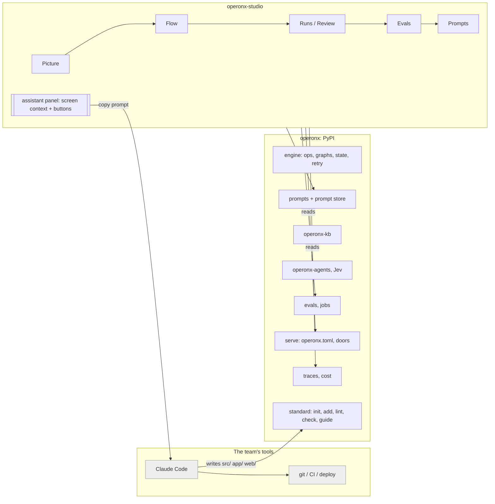
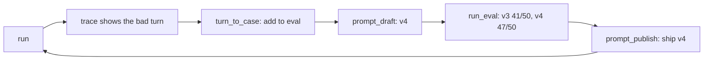

# Lean product plan: operonx builds AI products, how people work is theirs

Status: **plan, not started** (2026-11-24). Repositories: Operon (this one), operonx-studio, and a new
`operonx-project`. Follows [LEAN_PROJECT_PLAN.md](LEAN_PROJECT_PLAN.md), which slimmed the process
layer. This plan takes that layer out of operonx entirely.

## 0. The rule

operonx standardises **what an AI product looks like** and helps you **make it better**. It does not
cover **how the code is written**: boards, cycles, git, terminals, turn hooks and deploy pipelines
belong to Claude Code, git and the team.

Every phase removes more than it adds. P4 is the one phase that adds; its budget is in §5.

```
before:  operonx = engine + product tools + a software-engineering process
after:   operonx = engine + product tools          Claude Code / git / team = the process
```

## 1. Audit (2026-11-24, Operon `59d96a90`, studio `4fc8e44`)

### 1.1 Sizes (Python lines unless marked)

| Area | Lines | Side |
|---|---|---|
| operonx/core | 21,653 | product |
| operonx/app (evals 8,755, serve 3,455, jobs 1,676, play, doors, declare) | 18,673 | product |
| operonx/providers | 13,878 | product |
| operonx/telemetry | 8,706 | product |
| operonx/cli | 4,082 | product, except `project.py` and the BRD part of `init` |
| operonx/lint | 1,325 | product (the standard), except C18 |
| operonx/guide (code 777; pages 4,297 md) | 777 | product, except the AGENTS.md autosync and the builder block |
| packages/operonx-kb | 28,570 | product |
| packages/operonx-agents | 17,275 | product |
| **packages/operonx-project** (4,424 code + 1,958 tests) | **6,382** | **process** |
| studio: all Python / JS / tests | 23,468 / 30,424 js / 16,294 | mixed |
| **studio: process modules** (list in §1.4) | **3,922 + 2,301 js + 2,450 tests** | **process** |
| studio: process code inside app.py, assistant.py, mcp.py | not measured; counted in P3 | process |

### 1.2 Usage evidence

- **Nobody works the board.** All 5 studio projects have `docs/brd/board.md`. Since the board
  became one file (2026-11-11), it has been touched 1–2 times per project, mostly by migration
  commits. mr-finance's last board commit is 2026-11-12.
- **Nobody uses the assistant.** The live studio's `~/.operonx/assistant.sqlite` holds 90 turns
  in all: 78 in the second half of September, 1 in October, 11 in early November. The last one is
  dated 2026-11-01. The owner works in Claude Code directly.
- **No runtime depends on operonx-project.** No project's `src/` or `app/` imports
  `operonx_project`. It was never published to PyPI (it is not in `publish.yaml`'s matrix). Its
  only users are `operonx project …`, `operonx init --brd`, the guide's builder block, studio's
  Board tab and 4 MCP tools, and one bench script (`bench/token_ab/run.py`).
- **Process rules cost money and buy no quality.** [COST_PLAN.md](COST_PLAN.md) round 3 compared
  an operonx project (A') with an empty folder (B). A' cost 1.6× B: $3.23 against $1.99 on T1–T9,
  $3.47 against $2.16 on T10–T17. B passed 36/36 at first try with 0 tests; A' passed 35/36.
  The extra calls came from AGENTS.md's ritual rules: re-read the guide before every API, verify
  through pytest + `operonx check`. Note what this does and does not show: it measures the
  AGENTS.md rules and the scaffold, not the board.
- **The autosync writes where it shouldn't.** Every `operonx` command run inside a project rewrites
  its `.operonx/guide/` copy and the marked AGENTS.md blocks (`operonx/cli/main.py:_autosync`). It
  rewrote mr-finance's AGENTS.md during a read-only check (memory: operonx CLI autosync hazard).

### 1.3 Operon: every module and command

| Item | Decision | Why |
|---|---|---|
| core, app, providers, telemetry, durable, checkpoint, prompts, prompt_store, io | **keep** | the product |
| packages/operonx-kb, packages/operonx-agents | **keep** | the product |
| packages/operonx-project (brd, board, adopt, status, plans, coder, brd_flow) | **move** → own repo, frozen | process; no runtime user |
| `operonx init` (hello/chat/agent, `--http/--web/--deploy`, `parts`) | **keep** | the standard |
| `operonx init --brd`, `templates/_brd/` (7 files), `brd_files`, `builder_block` | **drop** | process |
| `operonx add` (route, job, model call, page) | **keep** | writes product code in the standard shape |
| `operonx run`, `serve`, `play`, `eval`, `prompt`, `studio` | **keep** | the product |
| `operonx lint` C1–C17 | **keep** | the standard (C1–C12 operonx correctness, C13–C17 the shape) |
| lint **C18** (a `docs/brd/knowledge.md` entry's file is gone) | **drop** | process |
| `operonx check` | **keep** | one verdict on the standard |
| `operonx project …` (cli/project.py) | **drop** | the new repo has its own `operonx-project` script |
| `operonx guide` (pages, `.operonx/guide/`, catalog) | **keep**, run on request only | helps Claude Code write operonx |
| `_autosync` before every command; AGENTS.md block sync | **drop** | writes on read-only commands; `operonx guide` refreshes when asked |
| `templates/_common/AGENTS.md` (230 lines) | **slim** | the COST_PLAN ritual rules |
| CI `packages.yaml` operonx-project job | **drop** | moves with the package |
| docs/*.md, 37 plan files at the top of docs/ | **move** closed plans → `docs/plans/` | a reader looking for docs finds the guide, not 37 plans |

### 1.4 Studio: every module

| Module | Lines | Decision | Why |
|---|---|---|---|
| app.py (routes), daemon, launch, registry, cache, minify, render, layout, theme | | **keep** | the shell and the graph view |
| runs, monitor, evals, play, services, runqueue, yamldoc, yamledit, envstatus | | **keep** | the product loop and settings |
| review, reviewqueues (operonx `[[queue]]`, a run read as a conversation) | 407 | **keep** | human review of *runs* is product. My earlier answer wrongly listed it as process |
| knowledge (kb) | 152 | **keep** | product |
| users, access (team sign-in) | 911 | **keep** | a team uses studio |
| safewrite (every write studio makes to a project) | 339 | **keep** | prompt and YAML edits need it |
| assistant.py, chat.py, mcp.py | 3,172 | **keep, cut** | see D5 and P3/P4 |
| operonx_studio_toolkit (extract, manifest, pyedit, edit, apply, templates) | 3,255 | **keep** | the Project IR and typed edits. Found on the way: `templates.py` pins operonx 1.17.1 |
| projectboard | 375 | **drop** | the Board tab |
| gitview, gitguard, gitpolicy | 782 | **drop** | git is the owner's tool |
| terminals (+ vendor/xterm) | 384 | **drop** | Claude Code and the shell |
| files (Project mode › Files) | 72 | **drop** | the editor |
| progress, runhook, stophook, testreport, basecheck | 1,414 | **drop** | hooks that police a coding turn: Claude Code's job |
| environments, deploy | 895 | **drop** | `operonx serve` stays. Deploying is the team's pipeline: qc-snatcher's `deployment/` is the bank's contract, callbot uses its own swarm scripts |
| JS: board, gitview, terminal, projectmode, progress, environments, waiting | 2,301 | **drop** | their screens |
| JS: factory\*, factory.css (the Picture) | ~1,245 | **keep** | the Picture. My earlier answer wrongly listed "factory" as process |
| JS: hand.js, choreo.js (the assistant points on screen) | 412 | **keep** | the assistant acting on the screen (D5) |

### 1.5 Studio: screens

| Today | After |
|---|---|
| **Project** hub: Now (assistant), Board, Git, Files, Terminal | gone; the assistant becomes a side panel on every screen |
| **Flow** hub: Picture, Flow, Prompts, Services (folded), Jobs (folded), Knowledge | **Picture is a project's first screen**; the rest stays |
| **Runs** hub: Runs, Review, Evals | stays |
| **Monitor** hub: Monitor, Alerts | stays |
| **Settings** hub: Resources, Environments, Storage, Project | Environments goes |

### 1.6 Assistant tools (mcp.py, 34)

| Keep (15) | Drop (18) | Add (P4) |
|---|---|---|
| list_runs, open_run, op_values, compare_runs, select_op, point, steps, monitor, run_job, rerun_op, play, run_eval, set_llm_price, list_projects, new_project | terminal_open/send/read/list/close, env_list/check/run/services, deploy, failing_on_base, on_base, project_status/search/read, board_status/card/move/cycle | turn_to_case (a run's turn → a dataset row), prompt_draft (a new version from an instruction), prompt_diff, prompt_publish (move a label) |

The 34 entries are 33 names: `steps` is registered for both the project scope and home.

## 2. Decisions

- **D1 — operonx-project moves to its own repo, frozen.** History comes along via
  `git subtree split`. Its CLI stays `operonx-project …`, installed from git. It pins
  `operonx>=1.46,<2` and gets no work unless someone asks. *Why:* the BRD reader and the board
  still run for anyone who wants them, and Operon's CI, versions and design stop carrying them.
- **D2 — studio's process screens are deleted, not made into an add-on.** Tag `pre-lean-product`
  on studio main first, so `git checkout pre-lean-product` brings everything back. *Why:* an add-on
  loader is new code for screens nobody opened (§1.2). The tag costs nothing.
- **D3 — the standard stays, with its names.** "core / backend / frontend" is already the shape:
  `src/` holds the features (core), `app/` the services and wiring (backend), `web/` the UI
  (frontend), and `operonx.toml` declares the parts, stores and serve. Lint C13–C17 and
  `operonx check` enforce it. *Why not rename to core/backend/frontend:* 5 projects and their lint
  baselines would churn for a label. The guide's 05-project-layout page states the mapping in one
  line instead.
- **D4 — `operonx init` writes AGENTS.md once.** `operonx guide` refreshes the guide copy and the
  marked blocks when asked; no other command writes them. The builder block goes. The template
  loses the ritual rules COST_PLAN measured ("re-read the guide page before an API", "verify through
  pytest + check") and keeps what Claude Code can't infer: the shape, the gotchas index, the
  commands. *Why:* the rules cost 1.6× for no quality, and the autosync wrote on read-only commands.
- **D5 — the assistant is a side panel that knows the screen and answers with buttons.** It is
  already headless Claude Code (`claude -p` with studio's MCP tools), so it was never weaker than
  Claude Code. It lost because it was a second place to do the same coding. After this plan:
  - it opens beside any screen, with that screen's selection as context (the run, the trace step,
    the prompt version, the eval);
  - it uses only product tools (§1.6), and ends each answer with UI actions: add to eval, draft
    v4, run the eval, compare, ship;
  - when a fix needs code, it writes a ready-to-paste prompt for Claude Code ("Copy for Claude
    Code") and does not edit `src/` itself;
  - the test for any feature: is this task faster here than in Claude Code? If not, it goes.

  Sessions, forks, streaming, attachments and usage (ChatStore, Relay) stay. The coding-turn
  machinery goes: live call watching, card turns, the board take/plan hooks and the stop hook.
- **D6 — the Picture is the first screen of a project.** Built only from `operonx.toml` and the
  `reads=`/`writes=` declarations, so nothing in this plan touches its source. Clicking a box
  opens that flow.
- **D7 — the projects keep their files.** `docs/brd/` (requirements, board.md) stays as plain
  Markdown in each project; nothing deletes it. `.operonx/project/*.db` becomes unused and is the
  owner's to delete. P5 only removes the generated AGENTS.md builder block.

## 3. Architecture after



The loop studio exists for, end to end without leaving it:



## 4. Folder structure after

```
Operon/
├── operonx/
│   ├── core/  app/  providers/  telemetry/  durable/  checkpoint/
│   ├── prompts.py  prompt_store.py  io.py …
│   ├── cli/          init add run serve play eval prompt lint check guide studio   (project.py gone)
│   │   └── templates/  _common/ hello/ chat/ agent/                                 (_brd/ gone)
│   ├── lint/         rules.py (C3–C12)  build.py (C1–C2)  shape.py (C13–C17)  prompts.py
│   └── guide/        01…09 pages, catalog; synced by `operonx guide` only
├── packages/
│   ├── operonx-agents/
│   └── operonx-kb/                                                                 (operonx-project gone)
└── docs/
    ├── guide/  api/  architecture/ …
    ├── LEAN_PRODUCT_PLAN.md  HANDOFF.md
    └── plans/        the closed *_PLAN.md files

operonx-studio/
├── operonx_studio/
│   ├── app.py  daemon.py  registry.py  launch.py  cache.py  render.py  layout.py  theme.py
│   ├── runs.py  monitor.py  evals.py  play.py  services.py  runqueue.py  review.py  reviewqueues.py
│   ├── knowledge.py  users.py  access.py  safewrite.py  yamldoc.py  yamledit.py  envstatus.py
│   ├── assistant.py  chat.py  mcp.py         (product tools only)
│   └── static/       picture (factory*), canvas, runs, evals, prompts, monitor, kb, settings, assistant panel
│                     (board, gitview, terminal, projectmode, progress, environments, waiting, xterm gone)
└── operonx_studio_toolkit/   extract manifest pyedit edit apply templates

operonx-project/      (new repo, frozen: the package as it was, history kept)
├── operonx_project/  brd/ board.py adopt.py status.py coder/ flows/
└── tests/

a product (the standard, unchanged)
my-product/
├── src/              features (core)       src/_shared/config.py reads the environment
├── app/              services, jobs (backend)
├── web/              UI (frontend)         only web/lib/ calls fetch
├── prompts/  tests/  data/  out/  deploy/
├── operonx.toml      parts, stores, serve
└── AGENTS.md         written once by `operonx init`
```

## 5. Phases

Every phase is one branch and one PR per repo. Each gate below must pass before the next phase
starts. Each part gets a write-up at `docs/lean_product_plan/<part>.md`: the tree before and after,
the files changed with one line each, a mermaid diagram where the flow changed.

### P1 — Operon: operonx-project leaves (removes ~6.6k lines)
- [ ] `git subtree split --prefix=packages/operonx-project` → a new private GitHub repo
      `operonx-project`; pin `operonx>=1.46,<2` and `operonx-kb>=0.2.6` there; its tests pass
      there against PyPI operonx
- [ ] delete `packages/operonx-project/`, `operonx/cli/project.py`, the `project` entry in `DELEGATED`
- [ ] `init`: drop `--brd`, `templates/_brd/`, `brd_files`, `BRD_DIR`, and the builder block
      (`guide.builder_block`, `_sync_builder`, `BUILDER_*`)
- [ ] lint: drop C18 (`shape.py`, `cli/lint.py` table)
- [ ] CI: drop the operonx-project job from `packages.yaml`; `bench/token_ab/run.py` stops importing it
- [ ] **Gate:** the full suite passes (3882 today, minus the removed tests); `grep -r operonx_project
      operonx/` is empty; `operonx init` in a temp folder writes the tree in §4 and `operonx check`
      passes there

### P2 — Operon: AGENTS.md written once, the guide on request
- [ ] remove `_autosync` from `cli/main.py`, plus `READ_ONLY` and its reason
- [ ] `operonx guide` is the only writer of `.operonx/guide/` and the marked blocks (it already is
      one writer; it becomes the only one)
- [ ] `templates/_common/AGENTS.md`: remove the ritual rules (§1.2) and keep the shape, the
      commands, and the gotchas index pointing at the guide
- [ ] 05-project-layout: one line mapping core/backend/frontend to `src/`, `app/`, `web/` (D3)
- [ ] move the closed plans to `docs/plans/` and fix the links
- [ ] operonx **1.47.0**: CHANGELOG; publishing to PyPI waits for the owner's OK
- [ ] **Gate:** suite green; running `operonx lint` inside a project leaves `git status` clean.
      Optional, paid, and only with the owner's OK: one COST_PLAN round, A'' (the slim AGENTS.md)
      against B on T1–T9, ~$5. The bar is A''/B < 1.3 at ≥ 35/36

### P3 — Studio: cut the process (removes ~8.7k lines + app.py/assistant.py/mcp.py parts)
- [ ] tag `pre-lean-product` on studio main and push the tag
- [ ] delete the modules, JS and tests marked **drop** in §1.4, `vendor/xterm`, and the Project
      hub and Settings › Environments in `project.html`
- [ ] app.py: remove their `register(...)` calls and the routes only they used
      (`/api/boards/waiting`, `git`, the Environments ones). `env-health` stays if envstatus serves it:
      check this before deleting
- [ ] mcp.py: remove the 18 tools in §1.6
- [ ] assistant.py: remove the live call watching (`_live_calls`, `_watch_*`, `stop_call`,
      `_progress_event`), card turns (`card_turns`, `_take`, `_plan`) and the stop/run hook wiring
- [ ] pyproject: drop the operonx-project dependency path
- [ ] **Gate:** studio tests green; the tab bar is the same on every screen (stable chrome); dark
      screenshots of the 4 hubs; the net line count is in the write-up

### P4 — Studio: the Picture first, the assistant as a panel (the one phase that adds)
- [ ] opening a project lands on the Picture
- [ ] the assistant panel is on every screen and gets the screen's selection as context
      (run id, trace step, prompt id and version, eval id)
- [ ] 4 new MCP tools: `turn_to_case`, `prompt_draft`, `prompt_diff`, `prompt_publish`. They call
      existing studio routes: `/prompts` (9 routes) and `datasets`. The tools add no new store
- [ ] answers end with UI actions, rendered as buttons (the existing `/ui/actions` channel)
- [ ] "Copy for Claude Code" on any answer that needs a code change; the assistant itself has no
      Edit/Write on `src/` (the chat mode's reach)
- [ ] budget: P4 adds at most 1/3 of the lines P3 removed
- [ ] **Gate:** the §3 loop done once on a real project (educa-reminder-agent's classifier prompt,
      on a copy) without leaving studio, recorded as screenshots. Assistant turns are Claude Code
      calls: about 10 turns, ~$3, and only with the owner's OK at the phase start

### P5 — Projects: nothing breaks
- [ ] for each of the 5 projects (mr-finance, qc-snatcher, meeting-prep-operonx,
      meeting-prep-brd, educa-reminder-agent): remove the generated AGENTS.md builder block where
      present (mr-finance has it) and bump to operonx 1.47.0 once it is on PyPI
- [ ] mr-finance: work on a copy in the scratchpad, never run operonx CLIs inside ~/mr-finance;
      push origin only
- [ ] callbot (educa-reminder-agent): on `refactor/operonx-studio` only
- [ ] **Gate:** each project's tests and `operonx check` show no new failure against its own
      baseline; live mr-finance :8030 restarted on the bump

### P6 — Close
- [ ] mark this plan DONE with each part's result; update HANDOFF.md; update memory

## 6. What each move breaks

| Dependent | What it uses today | After |
|---|---|---|
| mr-finance | `docs/brd/` (124 commits), board.md, AGENTS.md builder block | docs stay; block removed in P5; `operonx-project` from git if wanted |
| qc-snatcher | board.md, knowledge.md (C18 warns on it; its baseline `{C7,C8,C10,C12,C15,C16}` has no C18) | nothing breaks; C18's warnings stop |
| meeting-prep-operonx / -brd | board.md, practices.toml (already unread since L1) | nothing breaks |
| educa-reminder-agent (callbot) | board.md, lint baseline `{C12,C13,C14,C15,C16}` | nothing breaks |
| live studio :8766 | runs studio main from ~/operonx-studio | restarted on the P3/P4 merge only with the owner's OK; its state (users, assistant.sqlite) is untouched |
| anyone with `operonx project …` in scripts | the command | "unknown command"; the message points to the operonx-project repo |

## 7. Risks

- **Someone did use a dropped screen and we didn't see it.** The usage evidence covers this box's
  studio only. Mitigation: the `pre-lean-product` tag; restoring a screen is one cherry-pick.
- **The slim AGENTS.md loses a rule that mattered.** Mitigation: the P2 paid round, if the owner
  approves it, measures quality as well as cost.
- **P4 drifts into a new process layer.** Mitigation: the "faster here than in Claude Code" test
  and the 1/3 budget, both checked in the write-up.
