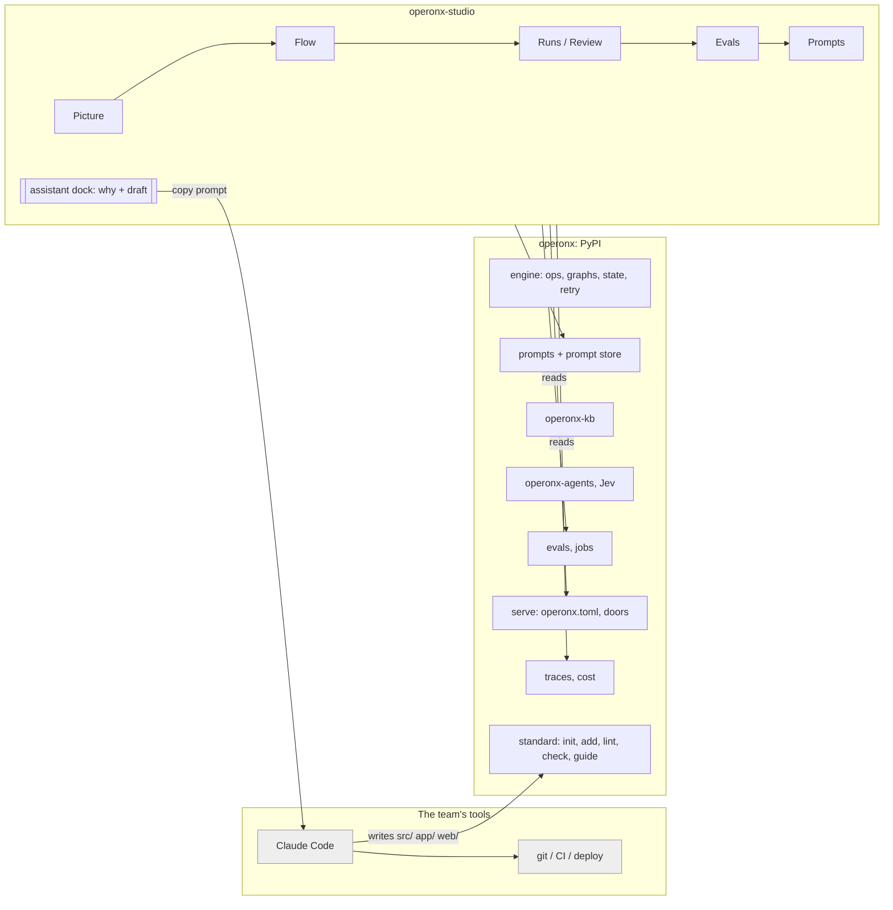
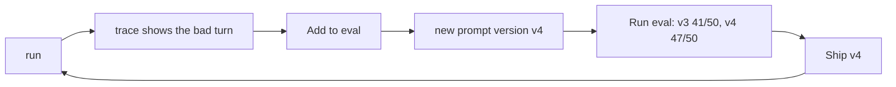

# Lean product plan: operonx builds AI products, how people work is theirs

Status: **DONE** (2026-11-24): every part is built and merged; the P4 gate passed the same day (5 real dock turns, $0.14, studio #275); the P3 gate is the owner's own use (§9). Reviewed twice and revised the same day, see §8. Repositories: Operon (this one), operonx-studio, and a new
`operonx-project`. Follows [LEAN_PROJECT_PLAN.md](LEAN_PROJECT_PLAN.md), which slimmed the process
layer. This plan takes that layer out of operonx entirely.

## 0. The rule

operonx standardises **what an AI product looks like** and helps you **make it better**. It does not
cover **how the code is written**: boards, cycles, git, terminals, turn hooks and deploy pipelines
belong to Claude Code, git and the team.

The plan removes far more than it adds. P3 and P4 are the phases that add, plus two small pieces
of core in P2 (the per-prompt pin and the stale-guide warning); the budget is in §5.

```
before:  operonx = engine + product tools + a software-engineering process
after:   operonx = engine + product tools          Claude Code / git / team = the process
```

## 1. Audit (2026-11-24, Operon `59d96a90`, studio `4fc8e44`)

### 1.1 Sizes (Python lines unless marked)

| Area | Lines | Side |
|---|---|---|
| operonx/core | 21,653 | product |
| operonx/app (evals 8,755, serve 3,455, jobs 1,676, play, doors, declare) | 18,673 | product |
| operonx/providers | 13,878 | product |
| operonx/telemetry | 8,706 | product |
| operonx/cli | 4,082 | product, except `project.py` and the BRD part of `init` |
| operonx/lint | 1,325 | product (the standard), except C18 |
| operonx/guide (code 777; pages 4,297 md) | 777 | product, except the AGENTS.md autosync and the builder block |
| packages/operonx-kb | 28,570 | product |
| packages/operonx-agents | 17,275 | product |
| **packages/operonx-project** (4,424 code + 1,958 tests) | **6,382** | **process** |
| studio: all Python / JS / tests | 23,468 / 30,424 js / 16,294 | mixed |
| **studio: process modules** (list in §1.4) | **3,922 + 2,301 js + 2,450 tests** | **process** |
| studio: process code inside app.py, assistant.py, mcp.py | not measured; counted in P1 | process |

### 1.2 Usage evidence

- **Nobody works the board.** All 5 studio projects have `docs/brd/board.md`. Since the board
  became one file (2026-11-11), it has been touched 1–2 times per project, mostly by migration
  commits. mr-finance's last board commit is 2026-11-12.
- **Nobody uses the assistant.** The live studio's `~/.operonx/assistant.sqlite` holds 90 turns
  in all: 78 in the second half of September, 1 in October, 11 in early November. The last one is
  dated 2026-11-01. The owner works in Claude Code directly.
- **No runtime depends on operonx-project.** No project's `src/` or `app/` imports
  `operonx_project`. It was never published to PyPI (it is not in `publish.yaml`'s matrix). Its
  only users are `operonx project …`, `operonx init --brd`, the guide's builder block, studio's
  Board tab and 4 MCP tools, and one bench script (`bench/token_ab/run.py`).
- **An operonx project costs an agent 1.6× an empty folder, and the rules are not why.**
  [COST_PLAN.md](COST_PLAN.md) round 3 compared an operonx project (A') with an empty folder (B):
  $3.23 against $1.99 on T1–T9, $3.47 against $2.16 on T10–T17. B passed 36/36 at first try with
  0 tests; A' passed 35/36. The AGENTS.md rules were already slimmed in rounds K1–K5 (the template
  now says "search the guide, read only that section" and "write a test when the task asks"), and
  arm L, which also dropped the verify ritual, was no cheaper ($3.34). What remains is the shape
  itself: an op, a graph and a `Service` per route, about 1.5× the lines. This says nothing about
  the board. It does say the standard this plan keeps (D3) has a price; the plan accepts it because
  the Picture, the traces and lint are built on that shape.
- **Not measured:** how much Environments, deploy, the terminals and the git view were used.
  Dropping them rests on the rule in §0, not on usage data.
- **The assistant already has a dock and already knows the screen.** `#chatdock` exists, and every
  message carries the selected op, the open run, tab, execution and filters (`app.py:_view_lines`).
  That did not get it used: 76 of its 90 turns are one two-day burst (09-27, 09-28).
- **Operon and studio keep their own backlogs as boards.** Operon's `docs/brd/board.md` has 43
  cards (COST_PLAN's C39–C42 among them). They are plain Markdown and stay.
- **The autosync writes where it shouldn't, and it has a second job.** Every delegated `operonx`
  command except the `READ_ONLY` ones (lint) rewrites the project's `.operonx/guide/` copy and the
  marked AGENTS.md blocks to match the *current interpreter's* packages
  (`operonx/cli/main.py:_autosync`). Run from a venv without operonx-agents and operonx-kb, `run` or
  `serve` deleted those pages: 459 lines in mr-finance on 2026-10-17. Its second job is real: after
  an operonx upgrade it refreshes the guide copy that Claude Code reads. Removing it must keep
  that, as a read-only warning (P2).
- **Most of the loop's buttons already exist.** Compare (`prompts.js:277`, `GET prompts/diff`),
  Publish (`prompts.js:261`) and "label production", which is Ship (`prompts.js:296`), are on the
  Prompts screen. Add to dataset is on Play (`play.js:460`) and Review (`review.js:142`, `POST
  review/run/{run}/dataset`). Missing: Add to dataset on a Runs trace, and running an eval
  against one chosen prompt version (next bullet).
- **An eval cannot run against one prompt version today.** `POST jobs/{name}/run` takes no prompt
  choice; it copies the server's environment (`app.py:job_start`). The only switch,
  `OPERONX_PROMPT_LABEL`, applies to every prompt, and a prompt without that label falls back to its
  working text, not production (`prompts.py:884`, `_load`). So labelling v4 `candidate` and running
  the eval would also move every other prompt from production to working text, and the 41→47
  comparison could be wrong.

### 1.3 Operon: every module and command

| Item | Decision | Why |
|---|---|---|
| core, app, providers, telemetry, durable, checkpoint, prompts, prompt_store, io | **keep** | the product |
| packages/operonx-kb, packages/operonx-agents | **keep** | the product |
| packages/operonx-project (brd, board, adopt, status, plans, coder, brd_flow) | **move** → own repo, frozen | process; no runtime user |
| `operonx init` (hello/chat/agent, `--http/--web/--deploy`, `parts`) | **keep** | the standard |
| `operonx init --brd`, `templates/_brd/` (7 files), `brd_files`, `builder_block` | **drop** | process |
| `operonx add` (route, job, model call, page) | **keep** | writes product code in the standard shape |
| `operonx run`, `serve`, `play`, `eval`, `prompt`, `studio` | **keep** | the product |
| `operonx lint` C1–C17 | **keep** | the standard (C1–C12 operonx correctness, C13–C17 the shape) |
| lint **C18** (a `docs/brd/knowledge.md` entry's file is gone) | **drop** | process |
| `operonx check` | **keep** | one verdict on the standard |
| `operonx project …` (cli/project.py) | **drop** | the new repo has its own `operonx-project` script |
| `operonx guide` (pages, `.operonx/guide/`, catalog) | **keep**, run on request only | helps Claude Code write operonx |
| `_autosync` before every command; AGENTS.md block sync | **drop**, replaced by a warning | it writes from whatever venv runs the command; `operonx check` says when the guide copy is stale and `operonx guide` refreshes it |
| `prompt()` version choice | **add** a per-prompt pin | an eval of one candidate version needs the other prompts left at production (§1.2) |
| `templates/_common/AGENTS.md` (230 lines) | **keep** | already slimmed in COST_PLAN K1–K5; a further cut was measured (arm L) and saved nothing |
| CI `packages.yaml` operonx-project job | **drop** | moves with the package |
| docs/*.md, 37 plan files at the top of docs/ | **keep** in place | 142 references point at them (112 outside docs/); moving them is churn |

### 1.4 Studio: every module

| Module | Lines | Decision | Why |
|---|---|---|---|
| app.py (routes), daemon, launch, registry, cache, minify, render, layout, theme | | **keep** | the shell and the graph view |
| runs, monitor, evals, play, services, runqueue, yamldoc, yamledit, envstatus | | **keep** | the product loop and settings |
| review, reviewqueues (operonx `[[queue]]`, a run read as a conversation) | 407 | **keep** | human review of *runs* is product. My earlier answer wrongly listed it as process |
| knowledge (kb) | 152 | **keep** | product |
| users, access (team sign-in) | 911 | **keep** | a team uses studio |
| safewrite (every write studio makes to a project) | 339 | **keep** | prompt and YAML edits need it |
| assistant.py, chat.py, mcp.py | 3,172 | **keep, cut** | see D5, P1 and P4 |
| guide/building.md (the assistant's own guide) | | **keep, cut** | it tells the assistant to run `operonx-project brd check` and `adopt` |
| operonx_studio_toolkit (extract, manifest, pyedit, edit, apply, templates) | 3,255 | **keep** | the Project IR and typed edits. `templates.py`'s `OPERONX_PIN = "1.17.1"` (the example projects' operonx) is raised in P1 |
| projectboard | 375 | **drop** | the Board tab |
| gitview, gitguard, gitpolicy | 782 | **drop** | git is the owner's tool |
| terminals (+ vendor/xterm) | 384 | **drop** | Claude Code and the shell |
| files (Project mode › Files) | 72 | **drop** | the editor |
| progress, runhook, stophook, testreport, basecheck | 1,414 | **drop** | hooks that police a coding turn: Claude Code's job |
| environments, deploy | 895 | **drop** | `operonx serve` stays. Deploying is the team's pipeline: qc-snatcher's `deployment/` is the bank's contract, callbot uses its own swarm scripts |
| JS: board, gitview, terminal, projectmode, progress, environments, waiting | 2,301 | **drop** | their screens |
| JS: factory\*, factory.css (the Picture) | ~1,245 | **keep** | the Picture. My earlier answer wrongly listed "factory" as process |
| JS: hand.js, choreo.js (the assistant points on screen) | 412 | **keep** | the assistant acting on the screen (D5) |

### 1.5 Studio: screens

| Today | After |
|---|---|
| **Project** hub: Now (assistant), Board, Git, Files, Terminal | gone; the assistant stays in its existing dock |
| **Flow** hub: Picture, Flow, Prompts, Services (folded), Jobs (folded), Knowledge | **Picture is a project's first screen**; the rest stays |
| **Runs** hub: Runs, Review, Evals | stays |
| **Monitor** hub: Monitor, Alerts | stays |
| **Settings** hub: Resources, Environments, Storage, Project | Environments goes |

### 1.6 Assistant tools (mcp.py, 34)

| Keep (15) | Drop (18) | Add (P4, after the stop point) |
|---|---|---|
| list_runs, open_run, op_values, compare_runs, select_op, point, steps, monitor, run_job, rerun_op, play, run_eval, set_llm_price, list_projects, new_project | terminal_open/send/read/list/close, env_list/check/run/services, deploy, failing_on_base, on_base, project_status/search/read, board_status/card/move/cycle | turn_to_case (a run's turn → a dataset row), prompt_draft (save a new version). Diff and publish are P3's buttons, not tools |

The 34 entries are 33 names: `steps` is registered for both the project scope and home.

## 2. Decisions

- **D1 — operonx-project moves to its own repo, frozen.** History comes along via
  `git subtree split`. Its CLI stays `operonx-project …`, installed from git. It pins
  `operonx>=1.46` and gets no work unless someone asks. The BRD template (`templates/_brd/`,
  `brd_files`) moves into it from core **before** core deletes it: the package imports it today. *Why:* the BRD reader and the board
  still run for anyone who wants them, and Operon's CI, versions and design stop carrying them.
- **D2 — studio's process screens are deleted, not made into an add-on.** Tag `pre-lean-product`
  on studio main first, so `git checkout pre-lean-product` brings everything back. *Why:* an add-on
  loader is new code for screens with no sign of use (the board, §1.2) or no usage data at all. The tag costs nothing.
- **D3 — the standard stays, with its names.** "core / backend / frontend" is already the shape:
  `src/` holds the features (core), `app/` the services and wiring (backend), `web/` the UI
  (frontend), and `operonx.toml` declares the parts, stores and serve. Lint C13–C17 and
  `operonx check` enforce it. *Why not rename to core/backend/frontend:* 5 projects and their lint
  baselines would churn for a label. The guide's 05-project-layout page states the mapping in one
  line instead.
- **D4 — no command writes a project's files unless asked.** `operonx init` writes AGENTS.md
  once; `operonx guide` refreshes the guide copy and the marked blocks when asked; `_autosync`
  and the builder block go. The autosync's second job, a fresh guide after an upgrade, becomes one
  read-only line from `operonx check`: "the guide copy is stale (operonx 1.47.0 installed, copy from
  1.46.1): run `operonx guide`". The template's text stays as it is. *Why:* the autosync wrote
  from whatever venv ran the command. A further cut of the rules was already measured and saved
  nothing (§1.2).
- **D5 — the loop is buttons first; the assistant keeps two jobs.** The assistant is already
  headless Claude Code with a dock and the screen's context, and that did not get it used (§1.2).
  So a better panel is not the fix. Most of the loop is already plain controls (§1.2): Compare,
  Publish and Ship on Prompts, Add to dataset on Play and Review. What studio lacks is the step
  in the middle and the path between them:
  - P3 adds **Add to eval** on a Runs trace, **Run eval on this version** (with a per-prompt pin
    in core, so the other prompts stay at production), and the eval's result shown next to the
    version before **Ship**. No model, no cost, the same result every time.
  - The assistant keeps only what needs a model: explaining why a run went wrong, and drafting
    the next prompt version. Its answers end with those same buttons.
  - When a fix needs code, it writes a ready-to-paste prompt for Claude Code ("Copy for Claude
    Code") and does not edit `src/` itself.
  - The gates are the owner's: they do the loop, not screenshots of it. After P3 there is a stop
    point: if a week of use never needed a model, P4 shrinks or is skipped.

  Sessions, forks, streaming, attachments and usage (ChatStore, Relay) stay. The coding-turn
  machinery goes in P1: live call watching, card turns, the board take/plan hooks and the stop hook.
- **D6 — the Picture is the first screen of a project.** Built only from `operonx.toml` and the
  `reads=`/`writes=` declarations, so nothing in this plan touches its source. Clicking a box
  opens that flow.
- **D7 — the projects keep their files.** `docs/brd/` (requirements, board.md) stays as plain
  Markdown in each project; nothing deletes it. `.operonx/project/*.db` becomes unused and is the
  owner's to delete. P5 removes the generated AGENTS.md builder block and rewrites mr-finance's
  hand-written board section.
- **D8 — a product's UI lives in its repo and is served with its API.** `web/` is optional; when a
  project has one, it is in the same repo, `operonx serve` serves it at `/` on the same origin as
  the routes, and the UI's backend is `app/`: the UI calls only `app/` routes, the logic stays in
  `src/`. Three rules keep a later move cheap:
  - `web/` is static files only; no page is rendered on the server;
  - every call goes through `web/lib/api.js` (C17), which has one `BASE` constant, `""` (same
    origin) by default;
  - every route the UI calls is under `/api/`.

  Moving the UI to its own repo and host later is then `git subtree split --prefix=web` plus either a
  reverse proxy that sends `/api/` to `operonx serve` (still one origin; no code change), or `BASE`
  set to the API's address plus CORS (`operonx serve` has no CORS today; it would be added then).
  Session cookies only survive the second way with `SameSite=None; Secure`, so the proxy is the
  default.

  *Why:* one origin means no CORS, no base URL and no config key; lint and the Picture see the UI;
  one deploy keeps the UI and the API at one version. Today only mr-finance has a `web/`, already
  in this shape (`app/web.py`, static pages, `fetch("/api/…")`). A CDN in front of the same origin
  still fits. A project whose client insists on a separate frontend is outside the standard: studio
  has no button for it and lint does not check it.

## 3. Architecture after



The loop studio exists for, end to end without leaving it. Every step is a button (most exist;
P3 adds Add to eval on a trace and Run eval on one version); the
assistant can help at B (why) and D (draft):



## 4. Folder structure after

```
Operon/
├── operonx/
│   ├── core/  app/  providers/  telemetry/  durable/  checkpoint/
│   ├── prompts.py  prompt_store.py  io.py …
│   ├── cli/          init add run serve play eval prompt lint check guide studio   (project.py gone)
│   │   └── templates/  _common/ hello/ chat/ agent/                                 (_brd/ gone)
│   ├── lint/         rules.py (C3–C12)  build.py (C1–C2)  shape.py (C13–C17)  prompts.py
│   └── guide/        01…09 pages, catalog; synced by `operonx guide` only
├── packages/
│   ├── operonx-agents/
│   └── operonx-kb/                                                                 (operonx-project gone)
└── docs/
    ├── guide/  api/  architecture/ …
    └── *_PLAN.md  HANDOFF.md                                                      (where they are)

operonx-studio/
├── operonx_studio/
│   ├── app.py  daemon.py  registry.py  launch.py  cache.py  render.py  layout.py  theme.py
│   ├── runs.py  monitor.py  evals.py  play.py  services.py  runqueue.py  review.py  reviewqueues.py
│   ├── knowledge.py  users.py  access.py  safewrite.py  yamldoc.py  yamledit.py  envstatus.py
│   ├── assistant.py  chat.py  mcp.py         (product tools only)
│   └── static/       picture (factory*), canvas, runs, evals, prompts, monitor, kb, settings, assistant dock
│                     loop buttons on runs and prompts
│                     (board, gitview, terminal, projectmode, progress, environments, waiting, xterm gone)
└── operonx_studio_toolkit/   extract manifest pyedit edit apply templates

operonx-project/      (new repo, frozen: the package as it was, history kept)
├── operonx_project/  brd/ board.py adopt.py status.py coder/ flows/
└── tests/

a product (the standard, unchanged)
my-product/
├── src/              features (core)       src/_shared/config.py reads the environment
├── app/              services, jobs (backend)
├── web/              UI (frontend, optional) static; served at / by operonx serve; only web/lib/api.js calls fetch (BASE = "")
├── prompts/  tests/  data/  out/  deploy/
├── operonx.toml      parts, stores, serve
└── AGENTS.md         written once by `operonx init`
```

## 5. Phases

Every phase is one branch and one PR per repo. Each gate below must pass before the next phase
starts. Each part gets a write-up at `docs/lean_product_plan/<part>.md`: the tree before and after,
the files changed with one line each, a mermaid diagram where the flow changed.

The order is studio first. Studio depends on operonx-project through an editable path into
`~/Operon/packages/operonx-project` (`pyproject.toml`), and the live studio runs from that checkout:
if the package left Operon first, the next pull of `~/Operon` would break the live studio's Board
import.

### P1 — Studio: cut the process (removes ~8.7k lines + app.py/assistant.py/mcp.py parts)
- [x] tag `pre-lean-product` on studio main and push the tag
- [x] delete the modules, JS and tests marked **drop** in §1.4, `vendor/xterm`, and the Project
      hub and Settings › Environments in `project.html`
- [x] app.py: remove their `register(...)` calls and the routes only they used
      (`/api/boards/waiting`, `git`, the Environments ones). `GET env-health` stays: it is the
      resource files' env-variable light in app.py (`_env_status`), not the Environments module.
      `POST /api/new` stays as it is: it calls `init_project` without the BRD option
- [x] mcp.py: remove the 18 tools in §1.6
- [x] assistant.py: remove the live call watching (`_live_calls`, `_watch_*`, `stop_call`,
      `_progress_event`), card turns (`card_turns`, `_take`, `_plan`) and the stop/run hook wiring;
      its top-level `progress` and `testreport` imports go with them
- [x] chat.py: remove the card-worktree code (`card_worktrees`, `worktrees_since`, `remove_worktree`)
      and the gitpolicy environment for the assistant
- [x] `operonx_studio/guide/building.md` (the assistant's own guide): remove the
      `operonx-project brd check` / `adopt` instructions
- [x] pyproject: drop the operonx-project dependency and its editable source
- [x] `operonx_studio_toolkit/templates.py`: raise `OPERONX_PIN` from 1.17.1 to studio's own
      operonx floor, so an example project starts on a current operonx
- [x] the assistant stays where it is for now: the existing dock (`#chatdock`), opened from the
      top bar, since the Now page goes with the Project hub
- [x] **Gate:** studio tests green; `git grep operonx_project` in studio is empty; the tab bar is
      the same on every screen (stable chrome); dark screenshots of the 4 hubs; the net line count
      is in the write-up. The live studio restarts on it only with the owner's OK

### P2 — Operon: operonx-project leaves, nothing writes behind your back (removes ~6.6k lines)
- [x] **before anything else:** the live studio :8766 runs P1's code, and `uv sync` in
      ~/operonx-studio has removed operonx-project from its venv (both with the owner's OK). Until
      then P2 does not merge: the live studio's venv still imports the package from
      `~/Operon/packages/operonx-project`, so the next pull of ~/Operon would break its next restart
- [x] `git subtree split --prefix=packages/operonx-project` → a new private GitHub repo
      `operonx-project` (needs the owner's OK)
- [x] **in the new repo first:** bring `templates/_brd/` and `brd_files` in from core
      (`operonx_project/brd/folder.py` imports `operonx.cli.init.brd_files` today), pin
      `operonx>=1.46` and `operonx-kb>=0.2.6`; its tests pass there against PyPI operonx
- [x] then in Operon: delete `packages/operonx-project/`, `operonx/cli/project.py`, the `project`
      entry in `DELEGATED`
- [x] `init`: drop `--brd`, `templates/_brd/`, `brd_files`, `BRD_DIR`, and the builder block
      (`guide.builder_block`, `_sync_builder`, `BUILDER_*`)
- [x] remove `_autosync` from `cli/main.py`, plus `READ_ONLY` and its reason; `operonx guide`
      becomes the only writer of `.operonx/guide/` and the marked AGENTS.md blocks
- [x] `operonx check`: one read-only line when `guide.changes(root)` is not empty, naming the
      installed version and `operonx guide` (D4); a test that it writes nothing
- [x] prompts: a per-prompt pin, `OPERONX_PROMPT_PINS="classifier=4"`, read by `prompt()` when
      no `version=` is given, so every prompt not named keeps its label (production). A composite's
      linked objects are pinned by their own names. Tests: a pinned prompt and an unpinned
      neighbour in one process; the run row names the pinned version
- [x] lint: drop C18 (`shape.py`, `cli/lint.py` table)
- [x] 05-project-layout: one line mapping core/backend/frontend to `src/`, `app/`, `web/` (D3), and
      D8's rule: same repo, served at `/`, static only, one `BASE` in `web/lib/api.js`, routes under
      `/api/`; plus the two ways to move the UI out later (a reverse proxy, or `BASE` + CORS)
- [x] `operonx init --web`: `templates/_common/web/lib/api.js.tmpl` gets `export const BASE = "";`
      and calls `fetch(BASE + path, …)`; the example route moves from `/greet` to `/api/greet`
      (`cli/init.py:98`) with the template's tests and README
- [x] CI: drop the operonx-project job from `packages.yaml`; `bench/token_ab/run.py` stops importing it
- [x] operonx **1.47.0**: CHANGELOG; publishing to PyPI waits for the owner's OK
- [x] **Gate:** the full suite passes (3882 today, minus the removed tests); `grep -r operonx_project
      operonx/` is empty; `operonx init` in a temp folder writes the tree in §4 and `operonx check`
      passes there; running `operonx lint` inside a project leaves `git status` clean; the new repo's
      tests pass against the 1.47.0 build

### P3 — Studio: the missing step of the loop, no model (adds; needs operonx 1.47.0)
Already there and reused as they are: Compare, Publish and Ship on Prompts; Add to dataset on Play
and Review (§1.2). P3 adds only what is missing:
- [x] opening a project lands on the Picture
- [x] **Open app ↗** in the top bar, opening the project's running `operonx serve` at `/` in a new
      tab (studio already knows each listener's host and port, `services.py`). It is always there:
      greyed with "no web/ in this project" or "not running" (stable chrome). No iframe: the app
      has its own login and cookies
- [x] on a Runs trace turn: **Add to eval**, the same dialog and row as Review's Add to dataset
      (`POST review/run/{run}/dataset`); no new route
- [x] on a prompt version: **Run eval on this version** → `POST jobs/{name}/run` takes
      `{"prompts": {"<name>": <version>}}` and passes it as `OPERONX_PROMPT_PINS` (P2); names and
      versions are checked against the prompt store before the job starts. This is the one route
      change
- [x] the eval's pass rate shown next to each prompt version that has one, so Ship (the existing
      "label production") is pressed knowing v3 41/50 and v4 47/50
- [ ] **Gate (the owner's):** the owner does one real loop in studio: a bad turn → eval case → a
      new prompt version → eval → ship, on a project of their choice. No paid calls except the
      eval's own

### Stop point
After P3 the owner uses the loop for a week. P4 goes ahead only if something in that week needed a
model: "why did this go wrong", or drafting the next version. If not, P4 shrinks to deleting what
the assistant no longer needs, or is skipped.

**Skipped (2026-11-24):** the owner asked for the whole plan in one go ("don't stop until the plan is
done"), so P4 was built without the week of use. Its gate is still the owner's.

### P4 — Studio: the assistant keeps two jobs (adds; needs the stop point's answer)
- [x] the briefing (`app.py:_view_lines`) also names the open prompt id and version and the open eval
- [x] 2 new MCP tools: `prompt_draft` (save a new version of the open prompt) and `turn_to_case`
      (the same row P3's button writes); it already has `run_eval` and `compare_runs`
- [x] its answers end with P3's buttons (the existing `/ui/actions` channel), not with text
- [x] "Copy for Claude Code" on any answer that needs a code change; the assistant itself has no
      Edit/Write on `src/`
- [x] budget: P3 + P4 together add at most 1/3 of the lines P1 removed
- [x] **Gate (the owner's):** one real question answered and acted on from the dock. Assistant
      turns are Claude Code calls: about 10 turns, ~$3, only with the owner's OK at the phase start.
      Passed 2026-11-24: 5 turns, $0.14. The labels miss was diagnosed, the Claude Code block applied,
      and v3 drafted and run; cases a–e pass ([P4](https://github.com/batman1m2001-cyber/operonx-studio/blob/main/docs/lean_product_plan/P4.md#the-gate-five-real-turns))

### P5 — Projects: nothing breaks
- [x] for each of the 5 projects (mr-finance, qc-snatcher, meeting-prep-operonx,
      meeting-prep-brd, educa-reminder-agent): remove the generated AGENTS.md builder block where
      present and bump to operonx 1.47.0 once it is on PyPI
- [x] mr-finance: its AGENTS.md also has a hand-written section, "Building it: docs/brd and the
      board" (lines 121–151), that tells the agent to run `operonx-project board`, `search`, `read`
      and `cycle`. Rewrite it to what is true after this plan: the board and the BRD are plain
      Markdown, edited directly. Work on a copy in the scratchpad, never run operonx CLIs inside
      ~/mr-finance; push origin only
- [x] mr-finance `web/`: move its `fetch` calls (`shell.js` ×4, `core/core.js` ×2, and
      `pages/holdings.js`, `pages/risktest.js`) into `web/lib/api.js` with `BASE = ""` (D8, C17).
      The pages keep working at the same URLs; check them in a browser against the live :8030 copy
- [x] callbot (educa-reminder-agent): on `refactor/operonx-studio` only
- [ ] **Gate:** each project's tests and `operonx check` show no new failure against its own
      baseline (met); live mr-finance :8030 restarted on the bump (the owner's)

### P6 — Close
- [x] mark this plan DONE with each part's result; update HANDOFF.md; update memory

## 6. What each move breaks

| Dependent | What it uses today | After |
|---|---|---|
| mr-finance | `docs/brd/` (124 commits), board.md, AGENTS.md builder block | docs stay; the generated block and the hand-written board section (AGENTS.md 121–151) are rewritten in P5; `operonx-project` from git if wanted |
| qc-snatcher | board.md, knowledge.md (C18 warns on it; its baseline `{C7,C8,C10,C12,C15,C16}` has no C18) | nothing breaks; C18's warnings stop |
| meeting-prep-operonx / -brd | board.md, practices.toml (already unread since L1) | nothing breaks |
| educa-reminder-agent (callbot) | board.md, lint baseline `{C12,C13,C14,C15,C16}` | nothing breaks |
| live studio :8766 | runs studio main from ~/operonx-studio | restarted on the P1/P3/P4 merges only with the owner's OK; its state (users, assistant.sqlite) is untouched |
| anyone with `operonx project …` in scripts | the command | "unknown command"; the message points to the operonx-project repo |

## 7. Risks

- **Someone did use a dropped screen and we didn't see it.** The usage evidence covers this box's
  studio only. Mitigation: the `pre-lean-product` tag; restoring a screen is one cherry-pick.
- **The loop buttons get no more use than the assistant did.** Mitigation: the P3 gate is the
  owner's own loop, and the stop point decides P4 on a week of real use.
- **P4 drifts into a new process layer.** Mitigation: the 1/3 budget, checked in the
  write-up, and one test for every feature: is this faster here than in Claude Code?

## 8. Review (2026-11-24)

The first version of this plan was checked against the code the same day. What changed and why:

| Was | Now | Evidence |
|---|---|---|
| Operon removal first, studio cut third | studio cut first | studio's editable dependency on `~/Operon/packages/operonx-project` |
| core deletes `brd_files`; the new repo pins `operonx<2` | the BRD template moves to the new repo first | `operonx_project/brd/folder.py:20` imports it |
| slim AGENTS.md's ritual rules; a $5 round to prove it | the template stays; no paid round | the rules were slimmed in K1–K5; arm L saved nothing |
| the assistant becomes a panel with screen context | the loop is plain buttons; the assistant keeps two jobs, after a stop point | the dock and the screen context exist and went unused |
| gates were screenshots | the P3 and P4 gates are the owner's own use | a screenshot shows a screen works, not that it is used |
| P5 removes the generated AGENTS.md block | it also rewrites mr-finance's hand-written board section | mr-finance AGENTS.md 121–151 |
| studio's assistant guide not listed | `guide/building.md` and chat.py's card worktrees are on P1's list | they call `operonx-project` |
| closed plans move to `docs/plans/` | they stay | 142 references |

A second review the same day checked the revised plan against the code:

| Was | Now | Evidence |
|---|---|---|
| P3 builds Add to eval, Compare, Run eval and Ship | P3 adds the missing pieces only: Add to eval on a Runs trace, Run eval on one version, the eval's result beside the version | Compare `prompts.js:277`, Publish `:261`, Ship `:296`, Add to dataset `play.js:460`, `review.js:142` |
| "Run eval" on a version calls an existing route | core gets a per-prompt pin (P2) and `jobs/{name}/run` takes it (P3) | the run route takes no prompt choice; `OPERONX_PROMPT_LABEL` is process-wide and falls back to working text (`prompts.py:884`) |
| studio first is enough to keep the live studio safe | P2 waits until the live studio runs P1 and its venv no longer has operonx-project | its venv imports the package from `~/Operon/packages/operonx-project` |
| `_autosync` is dropped | dropped, and `operonx check` warns when the guide copy is stale | its second job is refreshing the guide after an upgrade |
| it "rewrote AGENTS.md during a read-only check" | `run`/`serve` from the wrong venv deleted 459 guide lines; lint was already exempt | `READ_ONLY` in `cli/main.py`; memory, 2026-10-17 |
| check whether `env-health` belongs to envstatus | it stays: it is app.py's env-variable light | `app.py:1870`, `_env_status` |
| the toolkit's 1.17.1 pin "found on the way" | raised in P1 | `operonx_studio_toolkit/templates.py:24` |

Added after the second review, at the owner's request: D8, a product's UI in the same repo and
served with its API, written so it can still move out later; guide 05 and `init --web` in P2, Open
app ↗ in P3, mr-finance's `fetch` calls into `web/lib/` in P5. Evidence: of the 5 projects only
mr-finance has `web/` (same origin, static, `fetch("/api/…")` in 4 files, no `web/lib/`);
`operonx serve` has no CORS.

## 9. Results (2026-11-24)

| Part | PR | Net lines | Result | Write-up |
|---|---|---|---|---|
| P1 studio cut | studio #272 | −10,739 (83 files) | Board, Project hub, Environments, terminals and 19 assistant tools gone; `git grep operonx_project` empty; the live studio :8766 restarted on it | [P1](https://github.com/batman1m2001-cyber/operonx-studio/blob/main/docs/lean_product_plan/P1.md) |
| P2 operonx-project leaves | Operon #323 | −7,218 (102 files) | operonx 1.47.0 on PyPI; the package lives in the private `operonx-project` repo; no `_autosync`, no builder block, no C18; `operonx check` prints a stale-guide note; `OPERONX_PROMPT_PINS`; `init --web` with `web/lib/api.js` and `/api/` routes | [P2](lean_product_plan/P2.md) |
| P3 the loop as buttons | studio #273 | +248 (13 files) | the Picture first; Open app ↗; Add to eval on a Runs trace; Run eval on vN; each version's pass rate beside Ship | [P3](https://github.com/batman1m2001-cyber/operonx-studio/blob/main/docs/lean_product_plan/P3.md) |
| P4 the assistant's two jobs | studio #274 | +158 (17 files) | `prompt_draft` (saved, not served), `turn_to_case`; the briefing names the open prompt and eval; answers end with P3's buttons; Copy for Claude Code; no Edit/Write on `src/` | [P4](https://github.com/batman1m2001-cyber/operonx-studio/blob/main/docs/lean_product_plan/P4.md) |
| P5 the projects | mr-finance #91, qc-snatcher #8, meeting-prep-projects #20, callbot `a38dca1` | — | all five on operonx 1.47.0 with no new test or check failure; mr-finance's AGENTS.md board section is plain Markdown and its pages reach the backend only through `web/lib/api.js` | [P5](lean_product_plan/P5.md) |

P3 + P4 add +406 lines against a budget of ~3,580 (1/3 of P1's cut).

Still open, the owner's:

- **P3 gate:** one real loop in studio (a bad turn → eval case → new version → eval → ship).

Done since, on the owner's request (2026-11-24): live studio :8766 restarted on P3 + P4, and live
mr-finance :8030 on mr-finance #91 + operonx 1.47.0.

