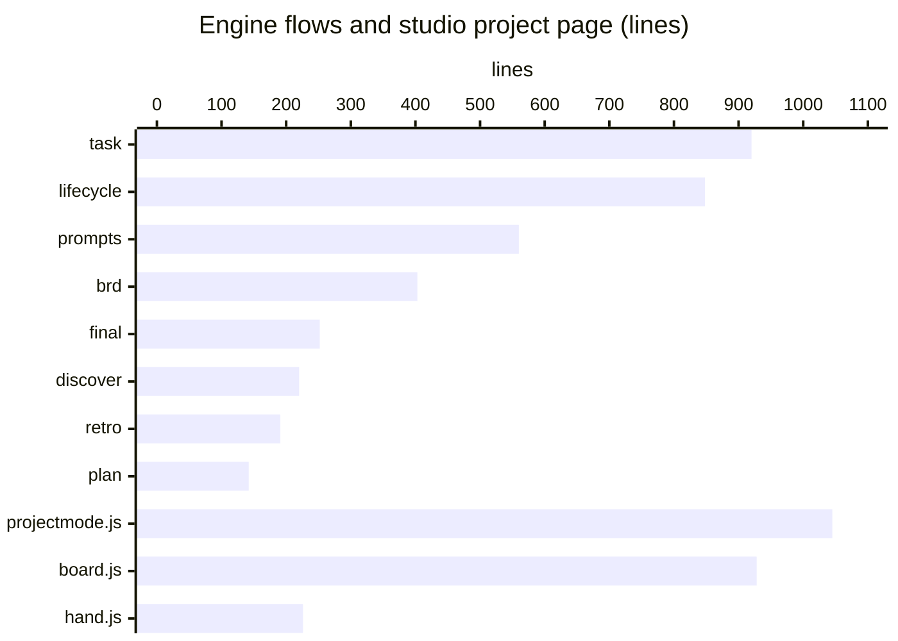
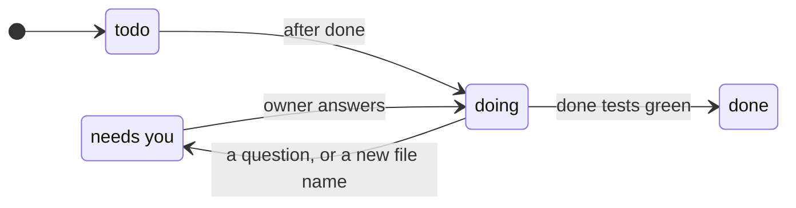
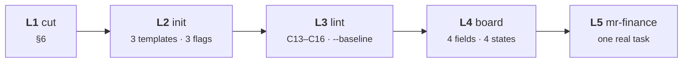

# One lean plan: the project's shape and its board

**Asked** (owner, 2026-11-11). "What is left in the plan? I fear overengineering most: ending up with a rough heap,
hard to control, like the code base today."

This plan replaces [PROJECT_CONVENTION.md](PROJECT_CONVENTION.md) and
[PROJECT_MODE_V2_PLAN.md](PROJECT_MODE_V2_PLAN.md). Their pictures stay as the reference; their scope is cut
to what is below.

---

## 0. The one rule

**Every phase removes more than it adds.** Each phase PR states, before and after: lines in the engine and the
studio, files `init` writes, lint checks, config keys. A phase that grows them does not merge.

## 1. The budget

| | the two plans | this plan |
|---|---|---|
| new lint checks | 10 (C13–C22) | **4** (C13–C16) |
| `operonx init` | 7 parts, 72 shapes | **3 templates × 3 flags, 18 shapes** |
| unit templates, `operonx add` | 10 | **0** now |
| card fields | 6 (lane, unit, req, after, files, done) | **4** (req, after, files, done) |
| card states | 5 | **4** (todo, doing, needs you, done) |
| plans | 2 | **1** |
| `practices.toml` | slimmed | **cut** |

What there is to cut today (lines):



The engine is 14,553 lines, `operonx lint` 914, `init.py` 359, the studio project page 2,406.

---

## 2. The shape

One picture per question. These are **doc rules**: nothing checks them until a count shows they drift.

| | picture |
|---|---|
| a feature's files | [layout.svg](project-convention/layout.svg) |
| the whole repo | [tree.svg](project-convention/tree.svg) |
| the web part | [web.svg](project-convention/web.svg) |
| who imports whom | [imports.svg](project-convention/imports.svg) |


- Fixed file names in a feature: `__init__` `routes` `jobs` `graph` `ops` `rules` `store` `source` `prompts`
  `agent`; anything else is `_private.py`.
- Code every feature needs goes in `src/_shared/`, which imports no feature.
- Backend is `app/` + `src/`; frontend is `web/`; runs write only to `data/` (keep) or `out/` (throw away).

Doc only, not checked: file names, tests mirroring `src/`, 500 lines per file, `fetch` only in `lib/api.js`,
where binaries go.

---

## 3. Four checks, on a ratchet

| | rule | mr-finance | callbot |
|---|---|---|---|
| **C13** | another feature only through its `__init__` names or its graph | 401 reach inside | 15 |
| **C14** | every endpoint is a `Service` | 63 hand routes | 0 |
| **C15** | env is read only in `src/_shared/config.py` | 51 reads, 20 files | 30 reads, 10 files |
| **C16** | the root holds only the allow-list; generated files only in `data/` or `out/` | 17 loose | 17 loose |

Each one is a hop in a bug hunt ([debug.svg](project-convention/debug.svg)): C14 gives every request a trace,
C13 and C15 keep the line in the folder the URL names.


New files are always clean. Old files move only when a card touches them.

---

## 4. `operonx init`


```toml
# operonx.toml — the only new key
[project]
parts = ["http", "web"]
```

- `operonx init . --web` later writes only missing files. For a file you edited (`app/main.py`) it prints the
  line to add.
- **Behaviour change:** plain `operonx init` gives offline `hello`. A doc that says "init, then serve" now says
  `operonx init --http`.

---

## 5. The board


A card in `docs/brd/board.md`:

```markdown
### C4 · gold jump alert · doing
req: NEWS-07 · after: C2
files: src/news/rules.py, tests/news/test_rules.py
done: tests/news/test_rules.py::test_gold_jump
```

- **The lane is read from `files`** (`web/` → UI, `routes.py` → web, `ops`/`rules` → core …), not written.
- **Two kinds:** *build* (a requirement) and *fix* (a red test or a bug).
- **States:** `todo → doing → done`; `needs you` when the assistant asks, or a card adds a file outside the
  fixed names. A card whose `after` is not done stays in todo, marked.
- The running card shows the live progress line (kept from today's `progress.py`).



---

## 6. Cut first

| keep | cut |
|---|---|
| board store + reader | discover / plan / final flows |
| `brd check`, on `requirements.md` only | review → held-out → QA stages, the examiner |
| `status`, one read-only summary | `practices.toml`, retro, LESSONS |
| studio turn checks, stop hook, `failing_on_base` | plan status blocks → milestone mirror |
| live progress (`progress.py`, runhook) | pages: Checklist · Questions · Changes · Graph |
| `operonx init` | `hand.js` |

Before each cut: grep for a second job. The Telegram bridge (0.7k lines) stays until the owner says whether
they use it.

## 7. Not now, and what brings it back

| not now | comes back when |
|---|---|
| `operonx add`, unit templates | the same boilerplate breaks two cards |
| more lint checks (names, tests, size, fetch, binaries) | a count shows the doc rule drifting in two projects |
| init `--jobs` `--store` `--llm` | two new projects hand-write the same part |
| lane as a card field; a `waiting` state | the owner cannot read the board without it |
| a web build step | a project needs React or Vite |

---

## 8. Phases



| | gate |
|---|---|
| L1 | engine and studio suites green; lines before and after, down |
| L2 | all 18 shapes pass `operonx lint` and their tests; `init . --web` on an existing project adds only missing files |
| L3 | tipcalc, qc, meeting-prep ×2 at 0; one deep import added on purpose turns lint red |
| L4 | light and dark screenshots; the assistant works one task card by card |
| L5 | the owner follows one real mr-finance task on the board alone; its first move (`control/` and the shared parts of people/wealth → `src/_shared`) takes 197 off C13; :8030 still serves; callbot green on a baseline |
