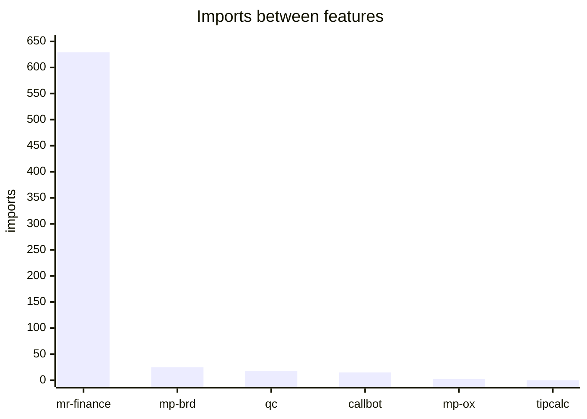
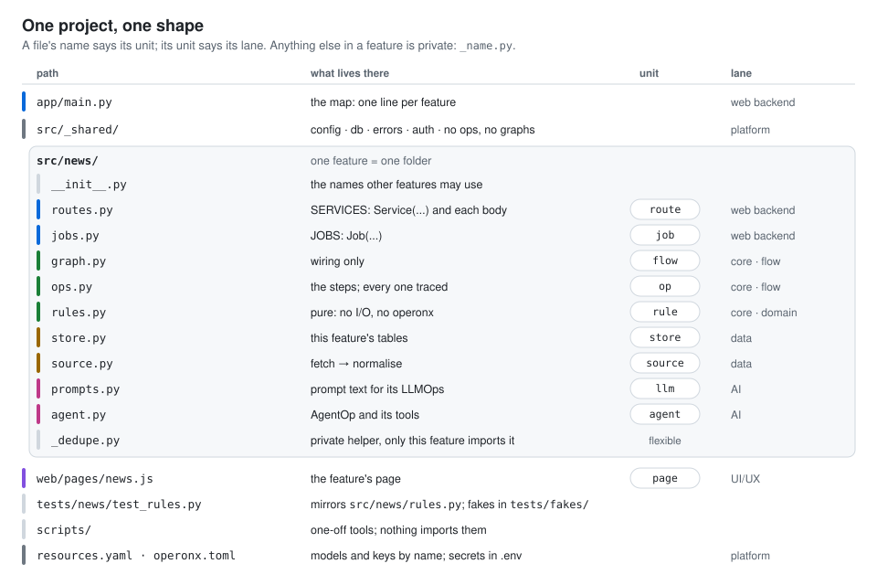
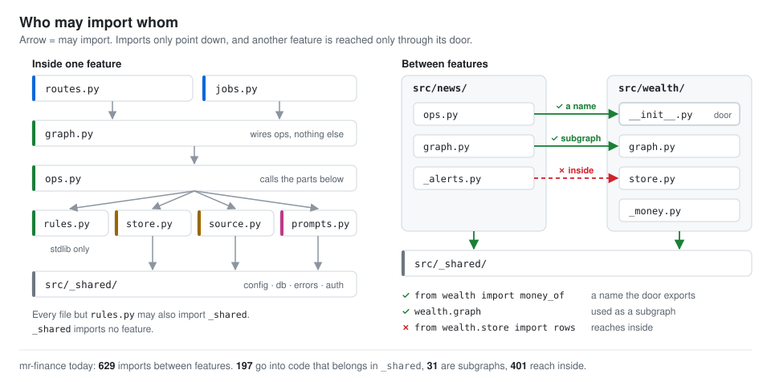
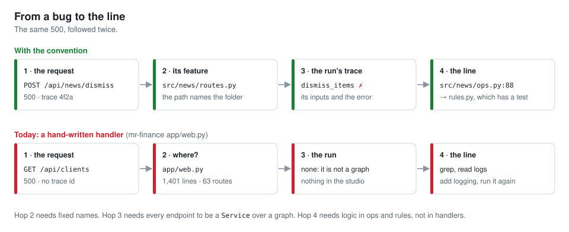
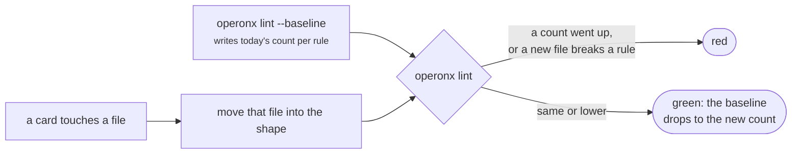
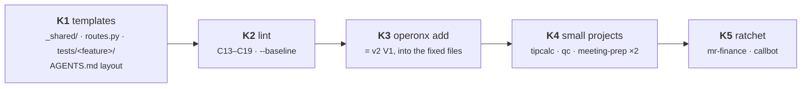

# Project convention: one shape for every operonx project

**Asked** (owner, 2026-11-11). `operonx init` gives the workflow core a clear shape (`graph.py` wires, `ops.py`
works). Give the whole project one: where each kind of code lives, who may import whom, and how a bug leads to a
line. The simpler the shape, the easier the project is to manage and to debug.

Companion to [PROJECT_MODE_V2_PLAN.md](PROJECT_MODE_V2_PLAN.md): a v2 **unit** is a **file name** here.

---

## 1. What the six projects show

**A rule holds when `operonx lint` checks it.** Rules that live only in a doc drift.

| rule | holds? | checked? |
|---|---|---|
| `graph.py` only wires (C10) | 5 of 6 clean; 1 file in qc-snatcher | ✅ lint |
| one feature = one folder | all 6 | ✅ `init` stamps it |
| features stay apart | only tipcalc: 0 imports between features | only tipcalc turned the check on (`practices.toml`) |
| file names say what's inside | mr-finance: 106 of 210 feature files have one-off names | ❌ |
| every endpoint leaves a trace | mr-finance: 63 hand-written routes in `app/web.py` | ❌ |
| env read in one place | mr-finance: 51 reads in 20 files · callbot: 30 in 10 | ❌ |
| tests findable from the code | mr-finance: 88 test files flat in `tests/` | ❌ |



mr-finance's 629 are mostly one hidden kernel: `control` (config, db, audit, errors) is imported 130 times as if
it were a feature. qc-snatcher grew the same thing as `src/core`. callbot is closest to the target: helpers are
private (`_vad.py`, `_tts.py`), tests mirror `src/`.

---

## 2. The shape



`app/main.py` stays the map, one line per feature. Each feature declares its own services and jobs:

```python
# app/main.py
from news import jobs as news_jobs, routes as news
from wealth import routes as wealth

APP = Application(
    "mr-finance",
    services=[*news.SERVICES, *wealth.SERVICES],
    jobs=[*news_jobs.JOBS],
)
```

`operonx serve --list` still prints every endpoint. A unit file over **500 lines** means the feature does two
jobs: split the feature, not the file (today: mr-finance `assistant/ops.py` 589, callbot `call/ops.py` 1,038).

---

## 3. Who may import whom



The door is the feature's `__init__.py`: the names it exports are the feature's API. Code that every feature needs
(config, db, errors, auth) is not a feature. It goes in `src/_shared/`, and `_shared` imports no feature.

---

## 4. Why this makes debugging short



---

## 5. The rules, each one checked

| # | rule | new lint check | mr-finance today | callbot today |
|---|---|---|---|---|
| R1 | a feature file is a unit name or `_private.py` | C13 | 106 of 210 | 4 of 49 |
| R2 | inside a feature, imports point down; `rules.py` imports the stdlib only | C14 | not measured | not measured |
| R3 | another feature only through its `__init__` names or its graph | C15 | 401 reach inside | 15 imports (not split) |
| R4 | every endpoint is a `Service` over a graph | C16 | 63 routes | 0 |
| R5 | env is read only in `_shared/config.py` (or `resources.yaml`) | C17 | 51 reads, 20 files | 30 reads, 10 files |
| R6 | `tests/<feature>/test_<unit>.py` mirrors `src/` · warn | C18 | 88 flat | 1 flat |
| R7 | a unit file stays under 500 lines · warn | C19 | 1 | 1 |

The unit names: `routes` `jobs` `graph` `ops` `rules` `store` `source` `prompts` `agent`, and `__init__`. They go
in `operonx lint` (core), not `practices.toml`, which v2 cuts.

---

## 6. Existing projects: a ratchet, no big bang

mr-finance runs on :8030 and callbot runs on staging. Neither moves all at once.



New files are always clean. Old files move only when a card touches them. mr-finance's first move is mechanical:
`control/`, plus the shared parts of `people` and `wealth` (auth, paths, money), → `src/_shared/`.
That takes 197 of its 629 imports between features off the count.

---

## 7. Phases



| | gate |
|---|---|
| K1 | the four `init` templates pass the new checks; their tests are green |
| K2 | a baseline for each of the six projects; lint is green; one deep import added on purpose turns it red |
| K3 | `operonx add rule news threshold` adds `threshold` to `src/news/rules.py` and a red test to `tests/news/test_rules.py` |
| K4 | every count at 0; each project's tests green |
| K5 | mr-finance's count goes down by at least 197 (`_shared`); :8030 still serves; callbot's suite is green |

**Change to v2.** With fixed names, a unit appends to its file (`rules.py`) instead of creating a new one
(`threshold.py`). §4 and §5 of PROJECT_MODE_V2_PLAN follow.
