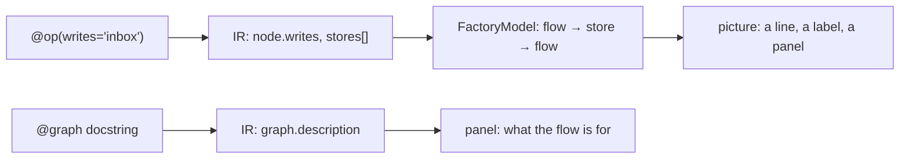

# Project declarations plan

**Status (2026-11-20):** D1, D2 and D4 done; D3 done for the callbot, qc-snatcher and both meeting-prep projects, mr-finance on its branch `decl/stores`.

**Why.** The studio's Factory picture shows a project as flows round a core, but a person cannot read
from it how the flows work together, what each is for, or what travels between them (the owner's review,
2026-11-19). The picture can only draw what the project declares. This plan adds the missing
declarations, then draws them.

## What the data says today (audit, on mr-finance)

| question | where the answer is | in the project's IR? |
|---|---|---|
| what a service or job is for | `Service(description=)`, `Job(description=)` | yes |
| what an op does | its docstring, or `description=` | yes |
| what a flow is for | the `@graph` function's docstring (14 of 14 flows have one) | **no**: the extractor does not export it |
| what a flow takes and gives back | the `@graph` parameters; `entries`, `exits`, `exports` | yes |
| which shared block or model a flow calls | nested graphs, `resource=` | yes |
| how two flows work together | they do not call each other: one writes a store, another reads it (`news_flow` keeps news in the inbox, `pages_flow`'s feed reads it) | **no**: nothing records which op touches which store |

So two things are missing, and only the second needs the engine.

## Decisions

- **A store is a name.** `@op(writes="inbox")`, `@op(reads=["inbox", "events"])`, or the same two
  keywords at the call (`keep(rows=..., writes="inbox")`). A name is whatever the project calls the
  thing: a table, a queue, a folder. One name means one store across the project.
- **Declared, not checked.** The engine stores the names on the op and does nothing else with them:
  no I/O is intercepted, nothing is validated at run time. A wrong declaration draws a wrong line; a
  lint check for that is D3's, where a project's store module can be named.
- **Describing a store is optional**, in `operonx.toml`: `[stores.inbox] description = "..."`. A
  store used by an op and not listed there is still drawn, under its name.
- **A flow's purpose is its docstring's first paragraph.** No new keyword.
- A parameter an op's own function calls `reads` or `writes` stays its input (the rule every setting follows).

## Parts

| part | where | what |
|---|---|---|
| D1 | operonx | `reads=` / `writes=` on `@op` and every op's constructor; `BaseOp.reads`, `.writes` (tuples) |
| D2 | operonx-studio | the extractor exports a graph's `description`, each node's `reads` / `writes`, and the project's `stores` (name, description, readers, writers); `[stores.*]` read from `operonx.toml` |
| D3 | mr-finance | its ops declare their stores; `[stores.*]` descriptions; a lint check that an op calling a store module declares it |
| D4 | operonx-studio | the picture: a Factory tab the project opens on; the core labelled as what is shared; stores drawn, with `flow → store → flow` lines; a label on every cable; one info panel per kind of thing (flow, service or job, cable, shared block, resource, store) |

## D1 — result

- `operonx/core/ops/base.py`: slots `reads`, `writes`; `_normalise_names` (a name or a sequence; a tuple, in order, once each; a non-string or empty name is a `TypeError`).
- `operonx/core/ops/transform/func_op.py`: `@op(reads=, writes=)`, overridable at the call.
- `operonx/core/ops/_shortcuts.py`: the two keywords are settings, not inputs.
- `tests/internal/core/ops/test_reads_writes.py`: 3 tests; `tests/internal/core` + `tests/spec`: 1,658 pass.

## D2–D4 — result

- **D2** operonx-studio #214: the IR carries `graph.description`, `node.reads` / `node.writes`, `stores[]`. Write-up: operonx-studio `docs/FACTORY_DECLARATIONS.md`.
- **D3**, widened by the owner to every project the studio opens (each also has its board, `docs/brd/board.md`):

  | project | stores | where |
  |---|---|---|
  | educa-reminder-agent | `calls` | 63c7532 on `refactor/operonx-studio` |
  | meeting-prep-operonx | `drafts`, `memory` | meeting-prep-projects #15 |
  | meeting-prep-brd | `approvals`, `reports`, `kb`, `memory`, `audit` | meeting-prep-projects #15 |
  | qc-snatcher | `corpus`, `runs`, `traces`, `baseline` | qc-snatcher #5 |
  | mr-finance | 16, derived from the SQL each op reaches (`scripts/stores.py`, checked by a test) | branch `decl/stores` |

  The lint check stayed in the project (mr-finance's `scripts/stores.py`): which tables make a store is the project's knowledge.
- **D4** operonx-studio #215: the Factory tab, the stores in the middle, the data lines, the card. Write-up: operonx-studio `docs/FACTORY_PANELS.md`. Left out: a line cannot be clicked (what moves along it is in the card of either end); a store only jobs use is not drawn.
