# Project mode v2 — one board, cards from units

**Asked** (owner, 2026-11-10). A Jira-like board. A task breaks into cards built from ready units; what no unit
covers is *flexible*. Layers kept apart. Templates only for patterns that really repeat. The running card is
highlighted and shows its progress. Nothing decorative.

---

## 1. Why

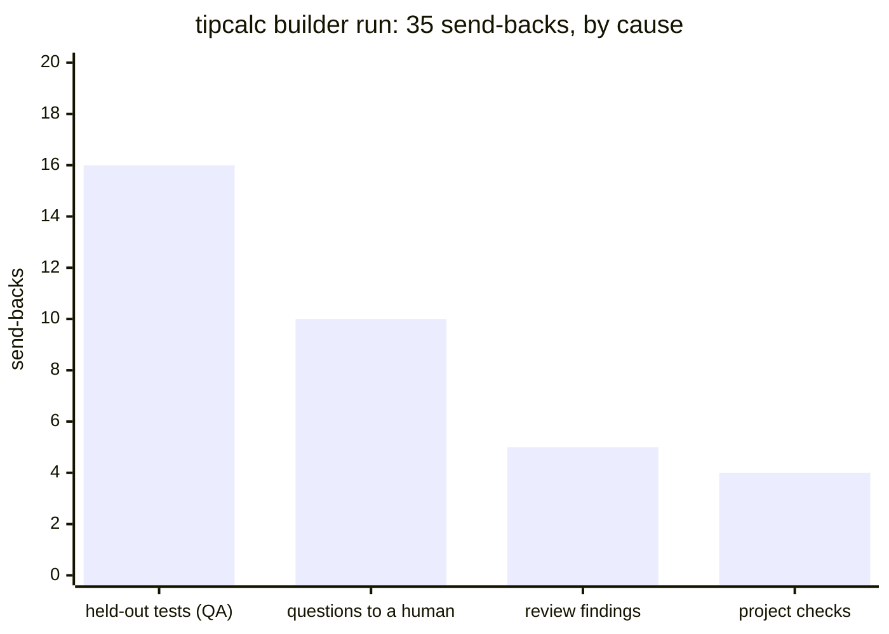

**0 of 90** assistant turns were tied to a board card · engine **14.5k** lines · studio project mode **~2k** lines of JS.

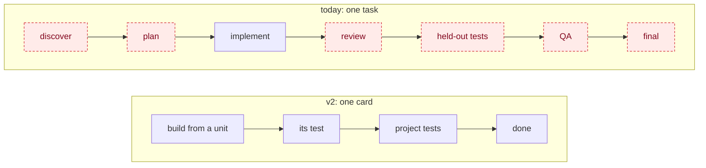

---

## 2. Architecture

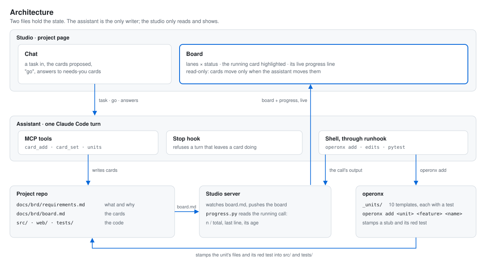

---

## 3. Lanes: clean architecture rings

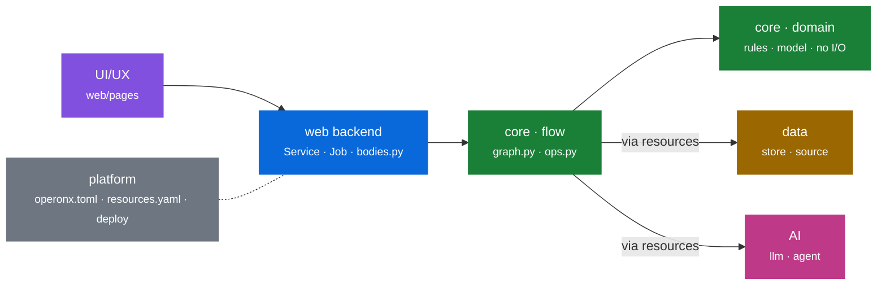

Arrow = *may import*. Domain imports nothing. Tests are not a lane: every card brings its own.

---

## 4. Units: the ready parts

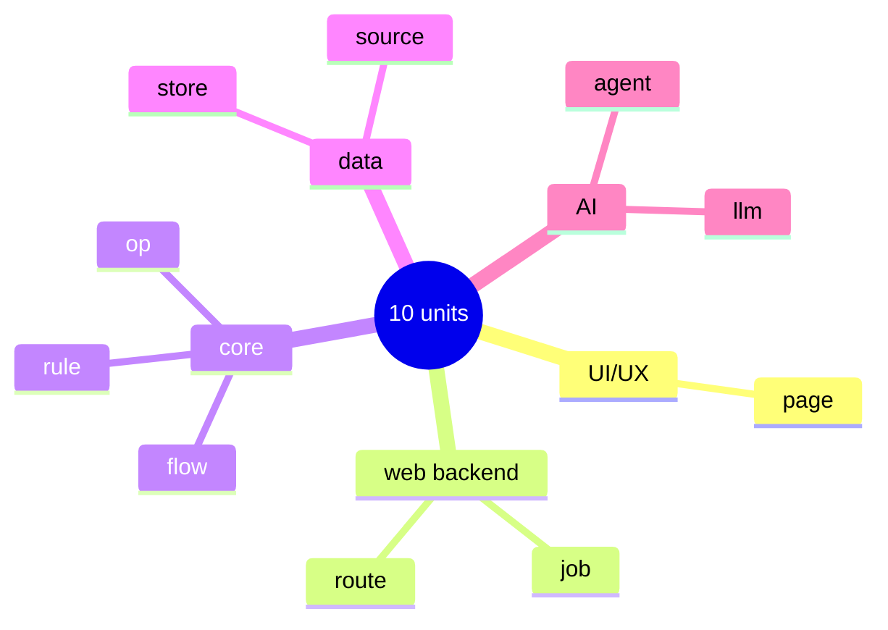

| unit | stamps | uses today (6 projects) | template from |
|---|---|---|---|
| op | `@op` in `ops.py` + unit test | 336 | `templates/hello` |
| flow | `graph.py` + run test | 91 | `templates/hello` |
| rule | pure module + test | 17 | tipcalc `money.py` |
| route | `Service(...)` + `bodies.py` + HTTP test | 93 | `templates/http`, mr-finance `news/bodies.py` |
| job | `Job(...)` + run test | 40 | mr-finance `app/main.py` |
| store | `store.py` (SQLite) + test | 15 | mr-finance `news/store.py` |
| source | fetch → normalise → store + fixture test | 5 | mr-finance `market/sources.py` |
| llm | `LLMOp` + prompt + fake-model test | 68 | `templates/chat` |
| agent | `AgentOp` + tools + fake-model test | 30 | `templates/agent` |
| page | `web/pages/<x>.js` + UI test | 39 | a small mr-finance page |

**Admission:** ≥ 3 uses in ≥ 2 projects, or ≥ 5 in one. Seen once or twice (`judge.py`, `mcp.py`, `golden.py`, `wav.py`) → stays flexible.

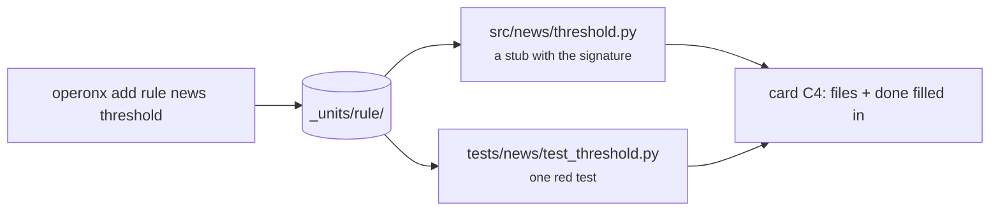

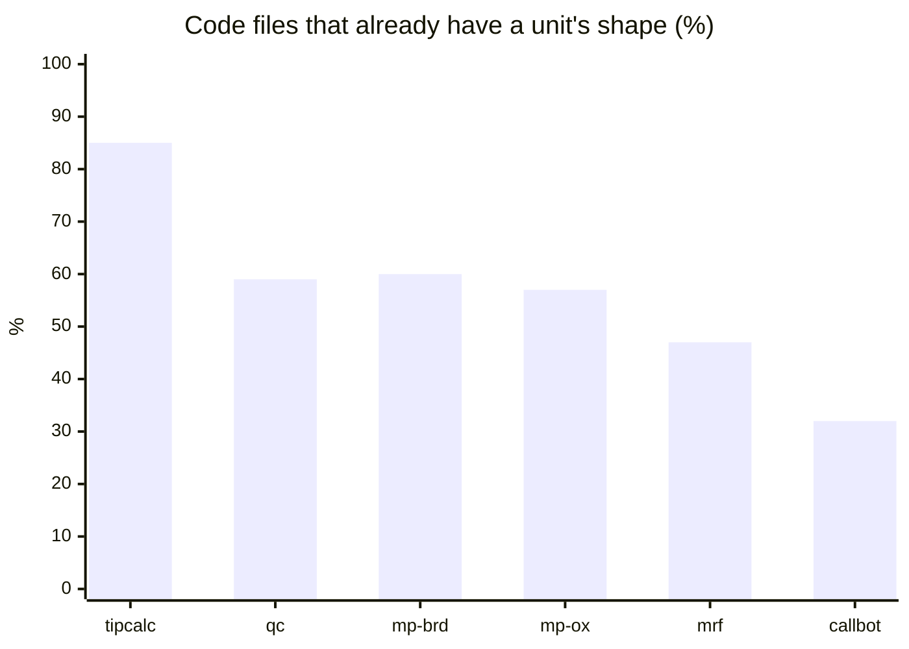

qc = qc-snatcher · mp = meeting-prep (brd, operonx) · mrf = mr-finance. 49 % of 477 files across the six projects. The rest (audio, valuation, signing, retention) is real project code
and stays flexible.

---

## 5. Cards

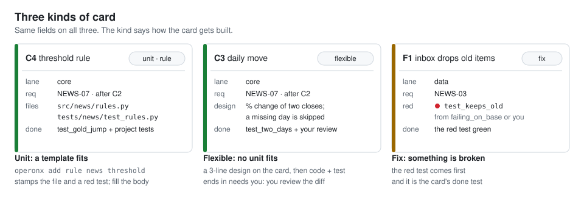

What the assistant writes in `docs/brd/board.md`:

```markdown
### C4 · threshold rule · doing
lane: core · unit: rule · req: NEWS-07 · after: C2
files: src/news/threshold.py, tests/news/test_threshold.py
done: tests/news/test_threshold.py::test_gold_jump, project tests
```

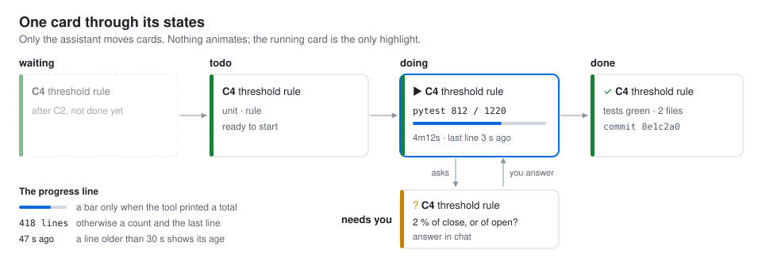

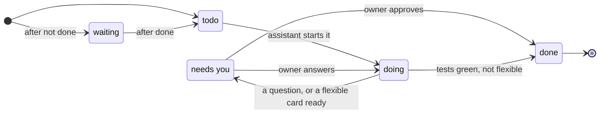

---

## 6. The board

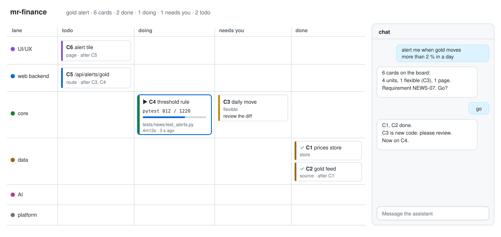

---

## 7. The implement flow

### 7a. A task becomes cards

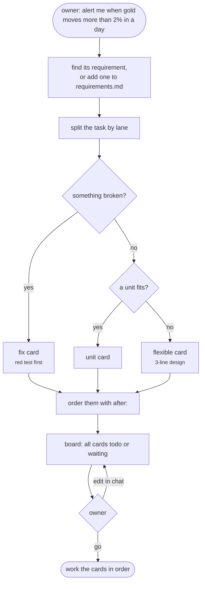

### 7b. The gold-alert task, as cards

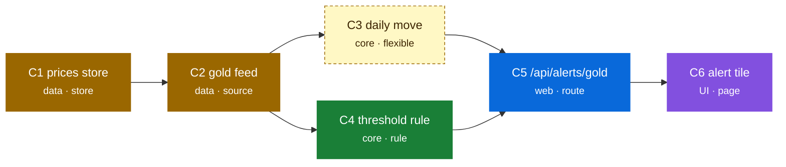

### 7c. Working the cards

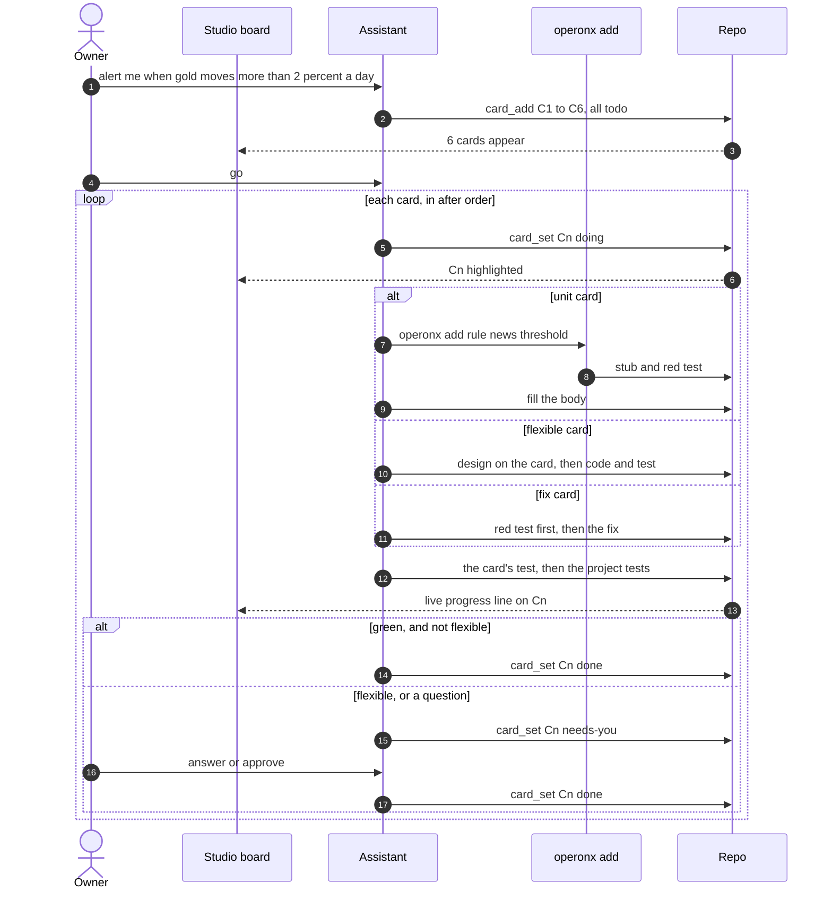

### 7d. Inside one card

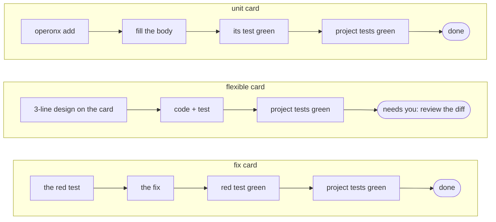

No QA stage, no held-out tests: the card's test and the project's tests decide.

### 7e. The progress line

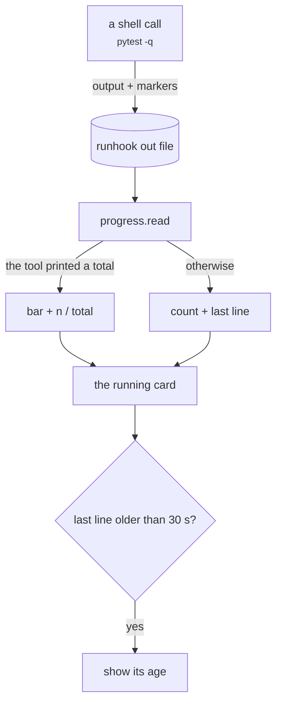

---

## 8. Keep and cut

| keep | cut |
|---|---|
| board store + reader (card format v2) | discover / plan / final flows |
| `brd check`, slimmed to `requirements.md` | review → held-out → QA stages, the examiner |
| `status`, one read-only summary | `practices.toml`, retro, LESSONS |
| studio turn checks, stop hook, `failing_on_base` | plan status blocks → milestone mirror |
| live progress (`progress.py`, runhook) | pages: Checklist · Questions · Changes · Graph |
| `operonx init` templates, plus `_units/` | decorative motion on the project page (`hand.js`) |

Before each cut: grep for a second job. The Telegram bridge (0.7k lines) stays until the owner says whether they use it.

---

## 9. Phases

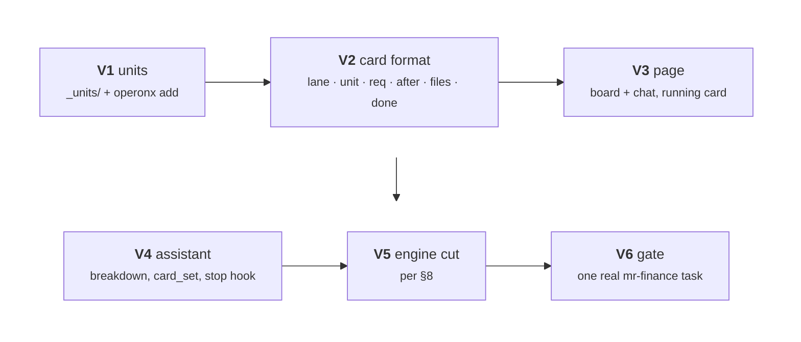

| | gate |
|---|---|
| V1 | every unit stamped into a scratch copy of `hello`; its test green |
| V2 | mr-finance, callbot, tipcalc boards rewritten; no card id lost |
| V3 | screenshots light and dark; a 2-minute test run never shows a stale line without its age |
| V4 | a Sonnet turn breaks a real task into cards with lanes and units |
| V5 | engine and studio suites green; line counts before and after |
| V6 | the owner follows one real task on the board alone, without reading the transcript |
