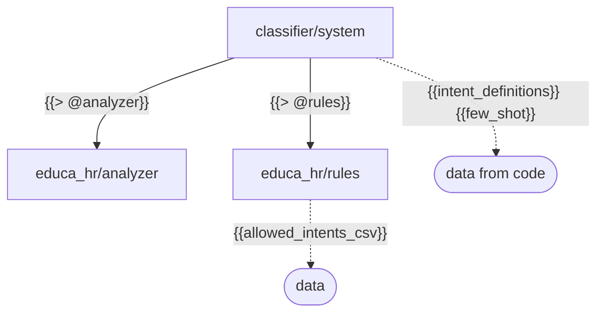

# Prompt layers plan

Status: proposed 2026-11-22. Nothing is built yet; implementation waits for the owner's "go".

## The problem, as the owner put it

> system points at two entities on the Prompts page, there is `system: {abc_prompt}`,
> and `abc_prompt` itself contains `{}` — it is very hard to tell a prompt's
> keywords from its variables.

Today one `{{x}}` slot can hold either **data** (a customer's words, a date) or
**another prompt** (a whole block of instructions). The reader can't tell which from
the template, and the Prompts page shows a flat list of names with no edges between
them. On top of that the five studio projects use four placeholder syntaxes, and
three of them don't use `operonx.prompts` at all, so the studio can't see their
prompts.

## Audit (2026-11-22)

| Project | Where the text lives | Syntax | Prompt inside a variable | Seen by studio |
|---|---|---|---|---|
| educa-reminder-agent (callbot) | `prompts/classifier/{system,user}.md`, `prompts/<agent>/analyzer.md` | `{{x}}`, plus `{x}` in YAML rules | yes: `{{analyzer}}` | yes |
| mr-finance | 16 `.md` in `prompts/`, ~100 lines of prompt text as Python constants | `{{x}}` (then `.format`), `<<x>>` (CIO), `{x}` (`.format` on constants) | yes: `facts`, `data`, `recount`, `voice`, `english`, `remembered`, `duties` | partly |
| qc-snatcher | 30 `*.prompt` files, flat dict by stem | `{x}`, `── DYNAMIC ──` split marker | yes: `time_prompt=`, `agreement_prompt=` | no |
| meeting-prep-operonx | 3 Python constants | `{x}` inline | `instructions()` joins text | no |
| meeting-prep-brd | `*.prompt` files by stem | `{x}` inline | no | no |

Evidence:

- **callbot.** `prompts/classifier/system.md` is `{{analyzer}}\n\n{{intent_definitions}}\n\n{{few_shot}}\n{{rules}}`. `src/agents/_prompt.py:83-93`
  fills `analyzer` with the prompt `<agent>/analyzer`. It builds `rules` in code from
  `config.classification_rules`, each run through `rule.format(allowed_intents_csv=…)`
  (`src/agents/ahamove_hr/agent.yaml:1387`). So the Prompts page shows
  `classifier/system` and `ahamove_hr/analyzer` as two unrelated entries. The `{allowed_intents_csv}` variable shows up nowhere.
- **mr-finance.** `src/assistant/turn.py:123` loads `assistant/rules` and `turn.py:240-265`
  fills 12 variables. Seven of them are prompt text kept as Python constants
  (`DUTIES` :99, `FACTS_MODEL` :124, `FACTS_TEMPLATE` :130, `DATA_RULE` :138,
  `RECOUNT` :149, `ENGLISH` :156, `VOICE` :164, `REMEMBERED` :199). `REMEMBERED` is itself
  `.format`-ed first.
  - CIO: `src/views/agents.py:251` → `views/prompts.py:77` replaces `<<k>>` (`<<guard>>`, `<<task>>`, `<<round>>`). The CIO prompts are DB-governed (two people + eval set).
  - `src/copilot/router.py:136` builds its system/user text inline.
  - `research/suggest.py` and `trial/daily.py` call `.format` on a `PromptText`.
- **qc-snatcher.** `src/_shared/prompts.py` loads `*.prompt` into `PROMPTS[stem]` and splits system/user on
  `── DYNAMIC ──`. Placeholders: `{transcript}`×22, `{evidence}`×5, `{context}`×4, and 5 others.
  `src/cases/raba/graph.py` passes whole prompts as arguments.
  `src/jobs/selfcheck/_baseline.py` tracks prompts by its own list.
- **meeting-prep-operonx.** `src/prepare/_prompts.py` holds TRIAGE / RESEARCH / BRIEF as constants.
  `graph.py` has an inline user template `"Company: {company}\n\nEvidence:\n{evidence}"`.
  `memory.py:54` returns `RESEARCH + HEADING + notes`.
- **meeting-prep-brd.** `src/agents/_shared/_prompts.py` loads `*.prompt` by stem.
  `extract_company/graph.py` has the user `"{facts}"`.
- **Engine.** `operonx/prompts.py:69-70` already has `{{x}}` and `{{> other}}`. But
  `_include` (:347) inlines the other prompt at load and keeps no record of it, so the tree is gone before
  anything can show it. `PromptText.render` (:121) accepts a `PromptText` as a variable
  value (`_plain`, :179) and records it as a sibling ref, flat (:132-134). `LLMOp` fills inline
  strings with `str.format_map` (`providers/ops/llm.py:1796`): that is the second syntax, `{x}`, and a
  `PromptText` turns its `{{x}}` into `{x}` to fit it (`_as_template`, :199).

Root cause: **composition is done through variables** (or in code), so a prompt's
structure is invisible, and data and text share one slot syntax.

## Two options

**A. Flat.** One message = one prompt file; variables are data only; no composition.
It is simple, but callbot would have to copy the shared classifier frame into every
agent's file (3 agents × the same 4-block frame), and mr-finance's rules × 7
switches would explode into combinations. Rejected.

**B. Prompt layers (owner's idea, recommended).** A prompt is a tree of
components. Composition is explicit and separate from data:

| Written | Means | Filled with |
|---|---|---|
| `{{x}}` | a variable | **data only** (str, number). A prompt given here is an error |
| `{{> shared/rules}}` | a fixed component | that prompt, resolved at load |
| `{{> @analyzer}}` | a component slot | a prompt chosen per call (or nothing) |

The engine keeps the tree instead of flattening it. A prompt's variables are the
union over its tree, and each one says which component it comes from.



How the callbot classifier reads after the change:

```text
prompts/classifier/system.md      {{> @analyzer}}

                                  {{intent_definitions}}

                                  {{few_shot}}
                                  {{> @rules}}
prompts/educa_hr/rules.md         <rules>
                                  1. CHỈ ĐƯỢC PHÉP chọn 1 intent … {{allowed_intents_csv}}
                                  </rules>
```

```python
SYSTEM.render(analyzer=prompt("educa_hr/analyzer"), rules=prompt("educa_hr/rules"),
              intent_definitions=…, few_shot=…, allowed_intents_csv=…)
```

## Decisions

1. **One placeholder syntax: `{{x}}`.** Prompt files never use `{x}` or `<<x>>`, and
   code never calls `.format` on prompt text. `LLMOp` keeps `str.format_map` for
   inline strings (no breaking change in the engine), but projects move every
   inline template that has prose into `prompts/`. Lint flags the rest.
2. **Variables are data.** Giving a `PromptText` or `RenderedPrompt` to `{{x}}` warns in
   1.44 (message: "use `{{> @x}}`") and fails in the next minor. Data containing
   `{{` is passed through literally and is never rendered again.
3. **Slots.** `{{> @name}}` takes a `PromptText`, a `RenderedPrompt` (its refs are kept as
   children), or `None` (empty). A slot that isn't filled is a `KeyError`, the same as a variable.
   A fixed component `{{> name}}` resolves at the same label as its parent (as today).
4. **The tree is recorded.** Each ref gains `parent` (the name above it, `None` at the
   root) and `via` (`include` | `slot`). Old readers that ignore the keys keep working.
   `PromptText` gains `components`, and `variables` becomes the union over the tree,
   with `variable_origins: {name: component}`.
5. **Versions stay per file.** A parent's version doesn't change when a component
   changes. The run row's tree shows which version of each component was used, so a
   trace is still exact.
6. **Byte-identical migrations.** Every project move is gated on rendering old and new
   for the same fixtures and getting the same bytes. Callbot already has
   `tests/agents/test_prompts_golden.py` (28 prompts). The others get one.
7. **mr-finance CIO stays governed.** Its `<<x>>` → `{{x}}` / `{{> cio/guard}}` change
   ships as new versions through its existing two-person + eval flow, not as a
   file edit.

## Phases

| # | Repo | Work | Gate |
|---|---|---|---|
| L0 | Operon | `{{> @slot}}`. Tree refs (`parent`, `via`). `components` / `variable_origins`. Warning on prompt-in-variable. `operonx prompts show <name>` prints the tree. Lint: P1 prompt in a variable, P2 `.format`/`<<`/`{x}` on prompt text, P3 inline template with prose. Docs + guide. | Existing prompt tests pass. New tests for slot, tree, warning, lint. 1.44.0 (PyPI after the owner says yes) |
| L1 | studio | Prompts page: each prompt shows *uses* / *used by*, and variables with the component they come from (`{{allowed_intents_csv}}` ← educa_hr/rules). Details: the chip is the root; open it to see the tree. One line per node, no text walls. | `node --test tests/js/` green. Screenshots on the callbot classifier, own branch |
| L2 | callbot | `analyzer` → slot. Rules out of `agent.yaml` into `prompts/<agent>/rules.md` with `{{allowed_intents_csv}}`. `.format` gone from `_prompt.py`. | Golden test byte-identical (28). P1–P3 = 0. On refactor/operonx-studio |
| L3 | mr-finance | `assistant/rules`: the 7 constants become components/slots (`assistant/facts-model`, `assistant/voice`, `assistant/duties/<role>`, …), and `turn.py` calls `.render`. suggest/daily: `.format` → `.render`. copilot router text → `prompts/copilot/`. CIO: new governed versions. | Rendered instructions byte-identical for every role × switch fixture. Assistant eval unchanged. P1–P3 = 0 |
| L4 | qc-snatcher, meeting-prep ×2 | `*.prompt` / constants → `prompts/*.md` via `operonx.prompts`. `── DYNAMIC ──` → `<x>/system.md` + `<x>/user.md`. `time_prompt=` → slots. selfcheck baseline reads prompt hashes. | Byte-identical per prompt. Each project's tests pass. Its prompts show on the studio Prompts page |

Overall gate: in all five projects, `grep` finds no `.format(` on prompt text, no
`<<x>>`, and no `.prompt` loader. `operonx lint` P1–P3 = 0. The studio shows every
project's prompts with their trees.

## Not in scope

- Changing what any prompt says (every move is byte-identical).
- Conditionals or loops inside templates (`{{#if}}`). A switch stays in code, which
  picks the slot's prompt or `None`.
- The prompt store (Postgres) schema: refs gain two keys and nothing else.
