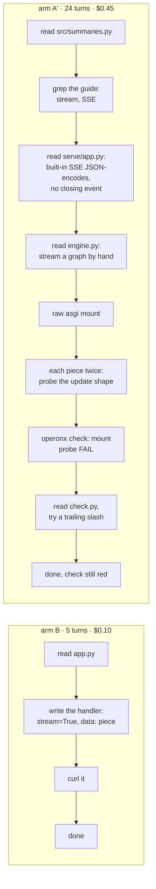

# E7b: tasks where reuse should win (gate 2)

Plan: [COST_PLAN.md § Gate 2 result](../COST_PLAN.md#gate-2-result-e7b) · board C37 · harness
[bench/token_ab](https://github.com/batman1m2001-cyber/Operonx/blob/main/bench/token_ab/README.md).

## The harness, before and after

```
bench/token_ab/                         bench/token_ab/
├── tasks.py      TASKS (T1–T6)         ├── tasks.py      TASKS (T1–T6) + E7B (T7, T8, T9)
├── accept.py     t1 … t6               ├── accept.py     t1 … t6 + t7 /timings, t8 SSE, t9 clock + resume
│                                       │                 service(**env) · job(check=False) · _sse()
├── fake_llm.py   flaky 503, 1 chunk    ├── fake_llm.py   + delay_ms, fail_summary_after,
│                                       │                 one word per streamed chunk, `streamed` count
├── run.py        fresh workspace       ├── run.py        + --ws TRACK=DIR: go on in an earlier run's
│                                       │                 workspace; E7B tasks only when named
└── results/                            └── results/      + 2026-11-15-k4-rerun.jsonl
                                                          + 2026-11-15-gate2.jsonl
```

T1–T6 still pass with the changed fake model: the streamed words join back into the same text.
A stdlib reference solution, written into a copy of a B workspace, passed T7–T9 before any money
was spent, and the unchanged T6 workspace failed all three with the right reason (`/timings` 404,
`/stream` 404, no scheduled summary).

## The three tasks

| task | asks | the hidden check |
|---|---|---|
| T7 | `GET /timings`: the last 20 `POST /tickets`, newest first, `{id, total_ms, model_ms}` | model waits 400 ms; ids newest first; 380 ≤ model_ms ≤ total_ms |
| T8 | `GET /summaries/{date}/stream`: the model's text as SSE, `"stream": true`, then `event: done` | text/event-stream; the model saw a stream call; ≥3 data events starting `SUMMARY:`; a `done` event |
| T9 | `daily_summary` every `$SUMMARY_EVERY` s inside `./run.sh`; `category_report` resumes | `SUMMARY_EVERY=2` + one 503: a summary of 2 tickets within 15 s; model down after 1 summary, the rerun calls it only for the rest |

## Where A' spent T8 (A2: 23 calls, 14 in operonx's source)



The framework had the pieces (a streaming LLM call, an SSE door), but not this shape: the text
as is, one event per piece, a named closing event. Without a recipe, the agent read the source.

## Numbers

| | A' | B |
|---|---|---|
| T7 | $0.24 · 14 turns | $0.21 · 11 |
| T8 | $0.81 · 49 | $0.21 · 10 |
| T9 | $0.67 · 46 | $0.27 · 14 |
| all, 12/12 passed first try | **$1.72 · 109** | **$0.68 · 35** |

Next levers (Backlog, not in this plan): C39 plain-text SSE, C40 a test scripts the fake model,
C41 `operonx check` without false reds, C42 `env()` with an int default in the offline build.

## Code changes

| file | change |
|---|---|
| bench/token_ab/tasks.py | `E7B`: T7, T8, T9, word for word for both arms |
| bench/token_ab/accept.py | `t7`, `t8`, `t9`; `service(**extra_env)`, `job(name, check=False)`, `_sse()`, `_mode(**more)` |
| bench/token_ab/fake_llm.py | `delay_ms`, `fail_summary_after`, per-word stream chunks, `streamed` count |
| bench/token_ab/run.py | `--ws TRACK=DIR`; E7B tasks run only when `--tasks` names them |
| bench/token_ab/README.md | the gate 2 command |
| docs/COST_PLAN.md | A' re-run after K4, Gate 2 result, Outcome |
| docs/brd/board.md | C37 done; C39–C42 in the Backlog |
