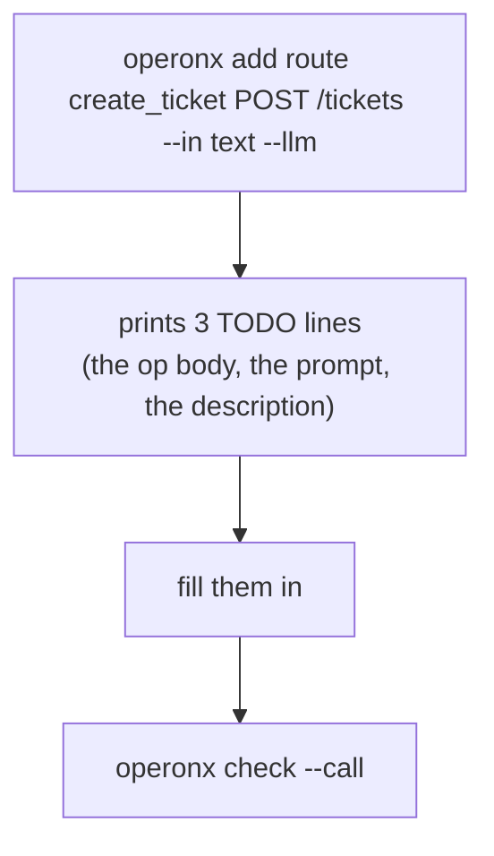

# K2: `operonx add` (before / after)

Plan: [COST_PLAN.md § K2](../COST_PLAN.md#k2-result) · board C35.

## Adding `POST /tickets` that classifies with the model

Before: the agent reads the template's four files, AGENTS.md's recipes, then writes and wires
each piece by hand (about 8 turns in the K5 pilot's T1):

```mermaid
flowchart TD
    a[read src/greeting/*.py<br/>to learn the shape] --> b[write ops.py: the op]
    b --> c[write graph.py: LLMOp then the op]
    c --> d[write routes.py: Service]
    d --> e[edit app/main.py: import + services list<br/>(after WEB? before?)]
    e --> f[uncomment llm:assistant,<br/>.env.example, the openai extra]
    f --> g[tests fail: LLM_API_KEY unset]
    g --> h[write a fake-model conftest]
    h --> i[operonx check]
```

After:



## What one command writes

```
$ operonx add route create_ticket POST /tickets --in text --llm
wrote src/tickets/__init__.py, src/tickets/ops.py, src/tickets/graph.py, src/tickets/routes.py,
      app/main.py, resources.yaml, .env.example, pyproject.toml, tests/conftest.py
fill in:
  src/tickets/ops.py:8  # TODO create_ticket: the logic. Its outputs are this dict's keys.
  src/tickets/graph.py:12  prompt={"system": "TODO create_ticket: what the model does, in one line.", "user": "{text}"},
  src/tickets/routes.py:12  description="TODO create_ticket: what a caller sends and gets back.",
then: uv sync
then: put LLM_API_KEY (and LLM_BASE_URL / LLM_MODEL) in .env
then: uv run operonx check --call
```

The project tree, before and after:

```
before                          after
app/main.py                     app/main.py            + from tickets.routes import SERVICES as TICKETS_SERVICES
                                                       + services=[*SERVICES, *TICKETS_SERVICES, WEB]
src/greeting/...                src/greeting/...
                                src/tickets/__init__.py
                                src/tickets/ops.py     @op create_ticket(text, answer)
                                src/tickets/graph.py   create_ticket_flow: LLMOp >> create_ticket
                                src/tickets/routes.py  Service("create_ticket", http("POST", "/tickets"))
resources.yaml (llm commented)  resources.yaml         + llm:assistant
.env.example                    .env.example           + LLM_API_KEY=
pyproject.toml operonx[serve]   pyproject.toml         operonx[openai,serve]
tests/greeting/...              tests/conftest.py      fake model for every test
```

The four verbs:

| command | writes | wired into |
|---|---|---|
| `add route NAME METHOD PATH [--in a,b] [--llm]` | op, graph, `Service` | `APP.services`, ahead of a mount at `/` |
| `add job NAME [--in a,b] [--llm] [--every 5m \| --at 07:00]` | op, graph, `Job` (`items=[{}]`, or `DATA/NAME.jsonl` keyed by the first input) | `APP.jobs` |
| `add llm NAME [--in text]` | a graph: one `LLMOp` | nothing (run it from a job, a route, `invoke`) |
| `add page NAME [--data /path]` | `web/NAME/index.html`, `web/pages/NAME.js` (a table), `get()` in `web/lib/api.js` | a link in `web/index.html` |

## Code changes (Operon, branch `cost/k2-add`)

| file | change |
|---|---|
| `operonx/cli/add.py` | new: the command. Source edits are AST-located splices; every Python file it writes must parse |
| `operonx/cli/main.py` | `add` delegated |
| `operonx/cli/templates/_common/AGENTS.md.tmpl` | Recipes open with `operonx add` (examples per part); Commands |
| `tests/internal/cli/test_add_cli.py` | route+llm then `check --call` green; second route; job with no inputs; `llm`; page; refusals |
| `CHANGELOG.md` | Unreleased › Added |
