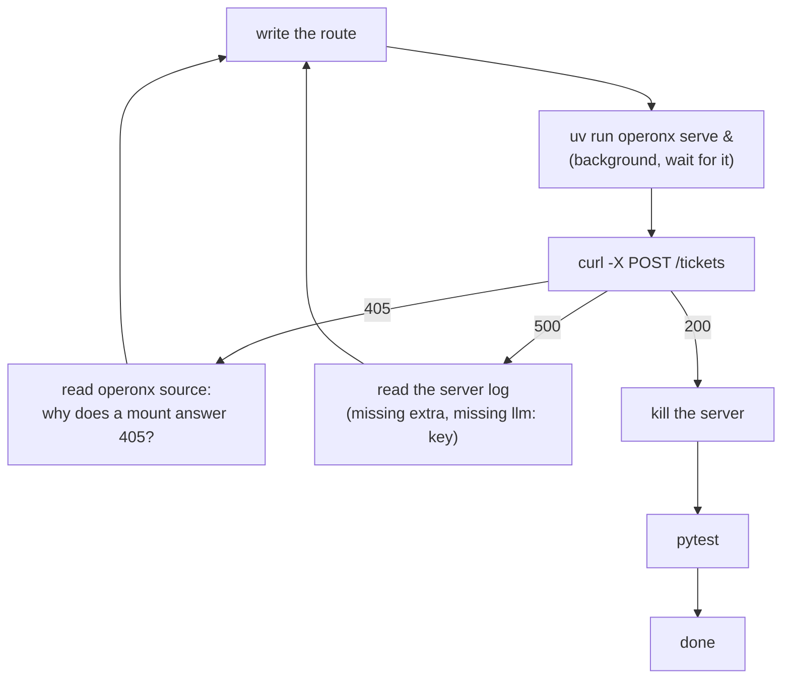
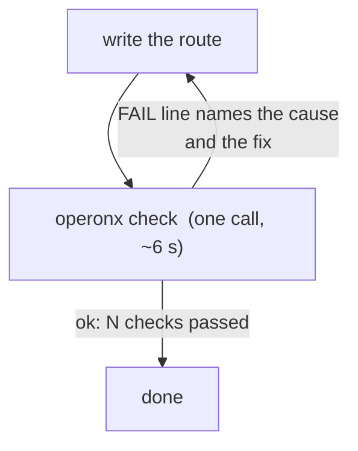
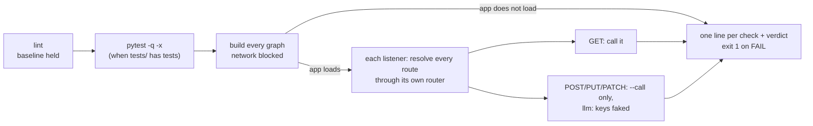

# K3: `operonx check` (before / after)

Plan: [COST_PLAN.md § K3](../COST_PLAN.md#k3-result) · board C34.

## How an agent verified a service

Before (the K5 pilot's T1 sessions, 16–25 turns):



After:



What `check` runs, in order:



## What a failure looks like

The two traps that cost T1 its turns, now one line each:

```
  FAIL  POST /tickets/   only /tickets/ reaches create; /tickets is answered by StaticFiles at /.
                         asgi(path) mounts a prefix: it answers /x/, not /x. Make the route a
                         Service with http(...) (AGENTS.md, Recipes: A route)
  FAIL  POST /greet      answered by StaticFiles at /, not service greet. a mount at / answers
                         every path: list it last in APP
```

A clean project:

```
operonx check: p
  ok    lint                   clean
  ok    tests                  3 passed in 1.56s
  ok    build                  3 graph(s) build offline
  ok    POST /greet            200 with {'id': 'check'}
  ok    POST /tickets          201 with {'text': 'check'}
  ok    GET  /tickets/{id}     404
  ok    GET  /                 200
ok: 6 checks passed
```

## The route recipe (scope added)

`check`'s first run failed lint C14 on the K5 recipe (a hand-written Starlette route). The http
door now does what that recipe was for:

| need | before (K5 recipe) | after |
|---|---|---|
| `201` on create | `JSONResponse(..., status_code=201)` in a Starlette route | an op outputs `"$status": 201` |
| `404` | the same | `"$status": 404` |
| `GET /tickets/{id}` | `request.path_params` in a Starlette route | `http("GET", "/tickets/{id}")`, `id` is a graph input |
| serving it | full paths in one Starlette at `/`, before the web mount | a `Service`, traced; the web mount listed last |

## Code changes (Operon, branch `cost/k3-check`)

| file | change |
|---|---|
| `operonx/cli/check.py` | new: the command |
| `operonx/cli/main.py` | `check` delegated; read-only (no guide autosync) |
| `operonx/app/serve/app.py` | http door: path parameters into the run's inputs; `"$status"` to the status code |
| `operonx/app/serve/runner.py` | `serve_session(keep=)`: an http door's reply keeps `$status` |
| `operonx/cli/templates/_common/AGENTS.md.tmpl` | step 3 is `operonx check`; Commands; the route recipe is a `Service` |
| `operonx/guide/02-composition.md` | § Service: path parameters, `$status` |
| `tests/internal/cli/test_check_cli.py` | clean project, `--call`, both traps, a broken app, no project |
| `tests/internal/app/serve/test_path_and_status.py` | path params, `201`/`404`, a clash, a bad `$status` |
| `CHANGELOG.md` | Unreleased › Added |
