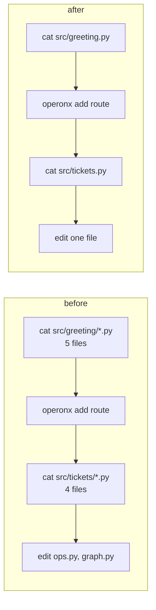
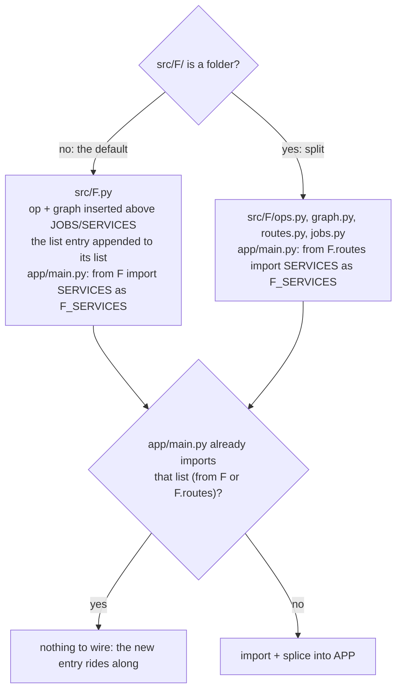

# K4: one file per feature (before / after)

Plan: [COST_PLAN.md § K4](../COST_PLAN.md#k4-result) · board C36. The two gate 1 fixes shipped in the
same PR are under [Gate 1 fixes](#gate-1-fixes).

## The project `operonx init` writes

```
before (hello --http)                  after
src/                                   src/
├── _shared/config.py                  ├── _shared/config.py
└── greeting/                          └── greeting.py        ops, graph, JOBS, SERVICES
    ├── __init__.py
    ├── ops.py        @op greet
    ├── graph.py      greet_flow
    ├── jobs.py       JOBS
    └── routes.py     SERVICES
app/main.py                            app/main.py
  from greeting.jobs import JOBS         from greeting import JOBS, SERVICES
  from greeting.routes import SERVICES
```

| template | before: files / lines | after: files / lines |
|---|---|---|
| hello (`src/greeting`) | 5 / 55 | 1 / 49 |
| chat (`src/chat`) | 6 / 74 | 1 / 66 |
| agent (`src/assistant`) | 6 / 107 | 1 / 90 |

The order inside the file is fixed: ops, then graphs (wiring only), then `JOBS`, then
`SERVICES`. Past ~300 lines the feature splits into `src/<feature>/` (`ops.py`, `graph.py`,
`jobs.py`, `routes.py`, an `__init__.py` re-exporting the lists) and `app/main.py` keeps its import.

## What an agent reads to add a route



## `operonx add` follows either shape



## Gate 1 fixes

| cause in gate 1 | fix |
|---|---|
| `GET /tickets` must answer a bare array; a door replied a dict (both T1 tracks failed, $0.90 of fix sessions) | an op that outputs `"$body"` answers that value alone, with its `$status` |
| `add job --at` wrote `schedule(at=...)` on port 8000; with `$PORT` set, `APP.asgi()` saw two listeners and every route test failed | in a served project `add job --at/--every` writes `port=PORT` |

## Code changes (Operon, branch `cost/k4-one-file`)

| file | change |
|---|---|
| `operonx/cli/templates/{hello,chat,agent}/src/<feature>.py.tmpl` | new: the feature in one file (17 files of the three folders removed) |
| `operonx/cli/templates/_common/app/main.py.tmpl` | one import, `from <feature> import JOBS, SERVICES` |
| `operonx/cli/templates/*/tests/*/test_*.py.tmpl` | import from the feature module |
| `operonx/cli/templates/_common/AGENTS.md.tmpl` | Layout: the one file, how to split, `Guide: 05-project-layout.md`; `--feature F` is `src/F.py`; a route goes in `SERVICES`; the imports rule; a clock takes `port=PORT`; `"$body"` |
| `operonx/cli/templates/_common/README.md.tmpl` | the feature in one file; grow it with `operonx add` |
| `operonx/cli/add.py` | `_feature_files` maps every part to `src/F.py` unless `src/F/` is a folder; `_above_lists` inserts code above the lists; `_module_of`; already wired = an import of the list from `F` or `F.<part>`; a clock in a served project gets `port=PORT` |
| `operonx/lint/shape.py`, `rules.py`, `cli/lint.py` | a feature is `src/F.py` or `src/F/` (C13); messages say "an op", "top-level names" |
| `operonx/app/serve/app.py`, `runner.py` | `"$body"`: the whole reply |
| `operonx/guide/05-project-layout.md`, `README.md`, `02-composition.md` | the worked project is `src/scoring.py`; the split rule; `"$body"` |
| `.gitignore`, `operonx/cli/templates/_common/web/lib/api.js.tmpl` | **bug on main:** `lib/` ignored the template's `web/lib/`, so a `--web` project from git or a wheel had a `home.js` importing a missing `lib/api.js`. Re-included and the file tracked |
| `tests/internal/cli/test_{add,init,check,lint}_cli.py`, `tests/internal/app/serve/test_path_and_status.py` | the one-file layout; a route of the template feature lands above its lists; a split feature gets the layered files; a clock rides on `PORT`; `$body` |
