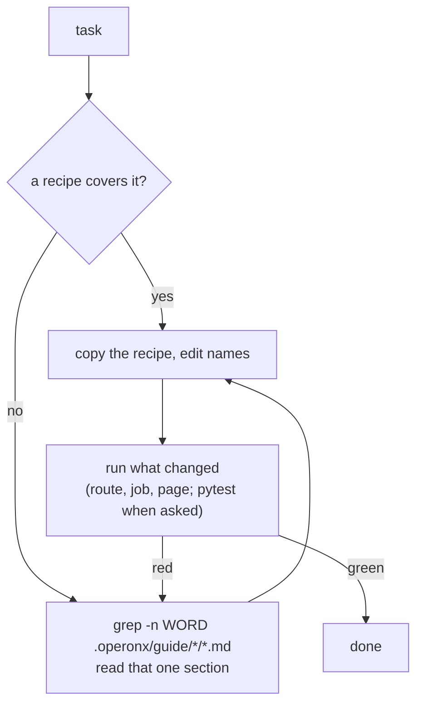

# K5 + K1: recipes in AGENTS.md, `docs/brd/` opt-in (before / after)

Plan: [COST_PLAN.md § K5 + K1](../COST_PLAN.md#k5--k1-result) · board C33.

## What an agent reads on turn one

Before (operonx 1.38.0 `operonx init`, every project had `docs/brd/`):

```
AGENTS.md (7.3 KB with the BRD block)
├── Before you write code      read the guide README, re-read a page before every API, read app/main.py
├── The ladder                 op → graph → Job → Service → Application → operonx.toml (words, no code)
├── Two rules the guide explains
├── Layout
├── Building it: docs/brd and the board   ← every project, BRD + board + CHANGELOG ritual
├── Commands
├── Rules
└── operonx guides             installed packages + Names/Branch lines
```

After:

```
AGENTS.md (5.4 KB jobs only, 6.9 KB with --http --web, + ~0.4 KB guide block)
├── How to work here           1 recipes first · 2 grep the guide, read one section · 3 run what you changed
├── Layout                     + `env("LIMIT", 10)` for a new setting      Guide: 05-project-layout.md § The files
├── Recipes                    each one: code that runs + the guide section to read for more
│   ├── op / graph                                       Guide: 01-ops.md § @op, § @graph; 04-gotchas.md
│   ├── A model call (LLMOp, fields=, stream=, the openai extra)   01-ops.md § LLMOp; 04-gotchas.md § LLMOp
│   ├── A branch (if_ / else_, & | ~)                    03-control-flow.md § if/else; 04-gotchas.md
│   ├── Retry (resources.yaml, @op(retry=), [retry])     06-failures.md
│   ├── A job (items, key, output, --resume, schedule)   02-composition.md § Job, § A job on a clock
│   ├── A route (http) + a Starlette route (201/404, full paths, one app at /)   02-composition.md § Service
│   ├── Test (op call, Job run, TestClient, fake model fixture)    01-ops.md § LLMOp
│   └── Why a run failed or is slow ($errors, .operonx/runs/)      08-runs.md; 04-gotchas.md
├── Building it: docs/brd …    only with `operonx init --brd`
├── Commands
├── Rules
└── operonx guides             installed packages, the README index, the grep line
```

Every `Guide: page § section` is checked by a test (`test_init.py`,
`test_every_guide_reference_in_agents_md_names_a_page_and_a_heading`): the page exists in `operonx/guide/core/` and the section
is a `## ` heading on it. A renamed heading fails the build, so the pointers cannot rot.

## The flow an agent follows



Before, the flow started with "read the README, then re-read a page before every API": ~58.5k
doc tokens on T1–T3. After: 4.9k.

## Code changes (Operon, branch `cost/k5-k1`)

| file | change |
|---|---|
| `operonx/cli/templates/_common/AGENTS.md.tmpl` | rewritten: "How to work here", Layout, Recipes with `Guide:` references |
| `operonx/guide/__init__.py` | `agents_block`: the index and the grep line; Names/Branch lines gone (they are recipes now) |
| `operonx/cli/init.py`, `operonx/cli/main.py` | `docs/brd/` only with `--brd`; `--no-brd` kept; re-init keeps what the project has |
| `tests/internal/cli/test_init.py` | `--brd` tests; every guide reference resolves |
| `CHANGELOG.md` | Unreleased › Changed |

## Result (pilot, 2 tracks × T1–T3, Sonnet)

| arm | cost | turns | doc tokens | passed | fixes |
|---|---|---|---|---|---|
| A (before) | $2.20 | 94 | ~58.5k | 6/6 | 1 |
| **A' (after)** | **$1.21** | **67** | **4.9k** | **6/6** | **0** |
| B (empty folder) | $0.56 | 30 | — | 6/6 | 0 |

A' is −45% cost and −29% turns against A; T2 and T3 are at B's level (5–8 turns), T1 is the gap
(16–25 turns against B's ~10). Rows: `bench/token_ab/results/2026-11-15-k5k1-pilot.jsonl`.

Why T1 still costs: both tracks mounted `asgi("/tickets")`, got 405 on `POST /tickets` (a mount
is a prefix: it answers `/tickets/`), and read operonx source to find out. Both then put
full-path routes in one Starlette at `/`. The recipe now says exactly that, and was run in a
generated project (`POST /tickets` 201, the http route 200, the page 200). A2 also hit
`No module named 'openai'` once; the recipe names the extra. The rest of T1 is building and
checking a service, which is what K3 (`operonx check`) and K2 (`operonx add`) target.
