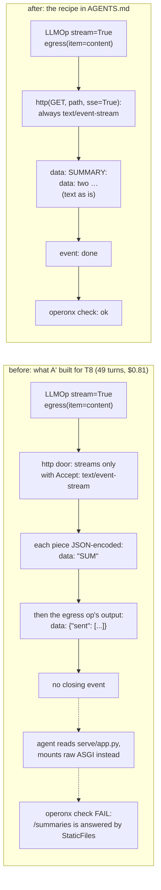
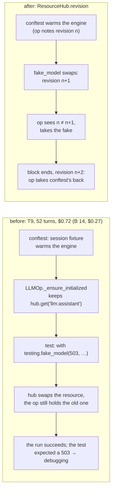

# Round 2: the four causes fixed (C39–C42)

Plan: [COST_PLAN.md § Round 2](../COST_PLAN.md#round-2-the-owner-chose-it-2026-11-15) · board C39–C42 ·
before: [E7b.md](E7b.md) (where A' spent gate 2).

## The streaming route, before and after (C39)



## What an agent meets, before and after

```
before                                        after
──────                                        ─────
AGENTS.md                                     AGENTS.md
├── Recipes: a route                          ├── Recipes: a route
│   (no stream recipe → read the source)      ├── Recipes: Stream a model's text   (sse=True)
└── Test: session fake_model fixture          └── Test: + testing.fake_model(...) for one test
    (a 503 test resets the hub by hand)
operonx check                                 operonx check
├── GET routes call the real model            ├── every model faked first, GETs too
├── raw asgi at /stream: "only /stream/ …"    ├── a mount of a raw app: not probed for /stream
└── lint C16: SPEC.md, run.sh are litter      └── C16: root *.md, *.sh, Dockerfile, compose ok
offline build                                 offline build
└── SUMMARY_EVERY = "operonx-lint-placeholder"└── SUMMARY_EVERY = "3600" (.env.example's value)
    env("SUMMARY_EVERY", 3600) → ValueError       env(..., 3600) on the placeholder → 3600
```

## Code changes

| file | change |
|---|---|
| operonx/app/declare.py | `PLACEHOLDER`; `env()` answers a number/bool default for it; `http(..., sse=False)` |
| operonx/app/doors.py | `sends(target)`: does the graph send with `egress` |
| operonx/app/serve/runner.py | a doorless run replies with its outputs only when it does not send |
| operonx/app/serve/app.py | `sse_text_frame`, `SSE_DONE`; an `sse` door always streams, text framing and `event: done`, on reconnect too |
| operonx/testing.py (new) | `fake_model(*turns, key=, **config)` context manager |
| operonx/cli/check.py | models faked before any route call; a `Mount` leaf is not probed for its bare prefix |
| operonx/lint/shape.py | C16 allows root `*.md`, `*.sh`, Dockerfile, compose files, Procfile |
| operonx/lint/build.py | `.env.example` values fill the build's env; the placeholder only when empty |
| operonx/cli/templates/_common/AGENTS.md.tmpl | check line; recipe "Stream a model's text"; per-test `testing.fake_model` |
| operonx/guide/01-ops.md, 02-composition.md | `stream=True` → SSE pointer; `fake_model`; egress without ingress; `sse=True` |
| tests | `test_sse_text.py` (7), `test_testing.py` (3), check (2), shape (1), declare (1), lint build (1) |

Each new test was seen to fail with its fix reverted (the SSE file 4/7, the mount probe with the
exact A1 message, the GET probe with a 500) before it was kept. Both recipes were run in a
generated `chat` project: its tests passed and `operonx check` was clean.

## Measured

Result and table: [COST_PLAN.md § Round 2 result](../COST_PLAN.md#round-2-result). Gate 1 $2.23 → $1.94
(B $1.31), gate 2 $1.72 → $1.29 (B $0.68), 20/20 first time; both gates still fail.

The run found one more cause, a bug in C40's fix. Before and after:



| file | change |
|---|---|
| operonx/core/registry/resource_hub.py | `ResourceHub.revision`: up on `register`, `remove`, `clear`, `set_instance`, `reset_instance` |
| operonx/providers/ops/llm.py | `LLMOp` resolves its models again when the revision moved (one int compare per call); models set on the op by hand stay |
| operonx/testing.py | `fake_model` bumps the revision when it puts the old resource back |
| tests/internal/test_testing.py | one engine kept across the block (fails without the fix) |
| bench/token_ab/run.py | `--start TRACK=TASK` resumes a cut run; turns summed over a session's result events |
