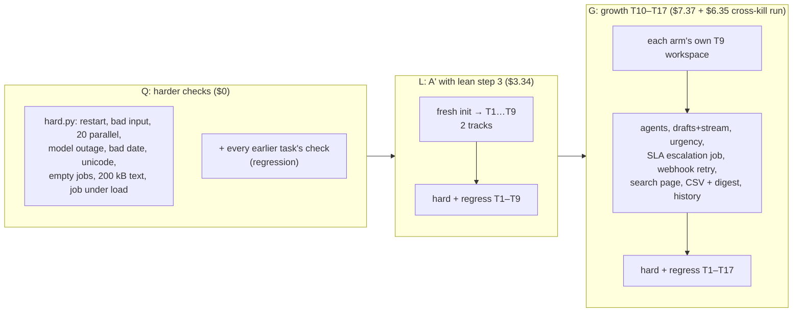

# Round 3: lean verification (L) and a growing project (G)

Plan: [COST_PLAN.md § Round 3](../COST_PLAN.md#round-3-why-a-costs-more-and-what-cutting-it-costs-in-quality-owner-2026-11-15) ·
result: [§ Round 3 result](../COST_PLAN.md#round-3-result) · before: [R2.md](R2.md).

## What ran



## Quality: what each arm got right

| | first try | fix sessions | hard probes (9) | regression T1–T17 |
|---|---|---|---|---|
| A' (T1–T9 round 2, T10–T17 here) | 35/36 | 1 | 8/9, both tracks miss `bad_input` | 36/36 |
| L | 34/36 | 2 | 8/9 on L2, 9/9 on L1 | 36/36 |
| B | **36/36** | 0 | **9/9** both tracks | 36/36 |

- `bad_input`: `POST /tickets {"text": 5}` answers 201 and stores the ticket. The http door fills a
  graph's parameters from the body by name, and an `@op`'s type hints (`text: str`) are not checked at
  run time. B's hand-written handlers check the type and answer 400. **A framework gap**, not the
  agent's: 3 of 4 operonx tracks have it, 0 of 2 B tracks.
- The three fix sessions were real bugs that the arm's own tests missed: A2 and L1 T13 built
  `GET /tickets/{id}` from a fixed field list that left `escalated` out; L2 T17 shadowed its
  `record()` helper with a local dict, so the escalate job crashed on history.
- B wrote **0 tests** across 17 tasks and had no regression and no fix. On this bench the ~600 test
  lines per operonx track bought no measurable quality.

## Cost: per task, 2 tracks summed

| | T1–T9 | T10–T17 | turns T1–T17 |
|---|---|---|---|
| A' | $3.23 | $3.47 | 215 + 164 |
| L | $3.34 | $3.90 | 248 + 190 |
| B | $1.99 | $2.16 | 128 + 95 |
| A'/B | 1.62 | **1.61** | |

A'/B by growth task: T10 1.4 · T11 2.4 · T12 1.3 · T13 2.3 · T14 1.3 · T15 0.9 · T16 1.9 · T17 1.2.
The ratio does not fall as the project grows.

## Why L did not save: the one line was not the whole pull

```
                         A' (round 2)    L
operonx check calls            47        14     ← step 3 worked here
pytest runs                    40        44     ← and not here
test lines at T9          275 / 280  246 / 176
```

Step 3 said "write a test only when the task asks". The rest of AGENTS.md still says
`Tests: tests/<feature>/`, `uv run pytest  # keep them green` and shows the `fake_model` fixture,
and the scaffold ships a test the agent extends. The agents followed the many lines, not the one.

## Why reuse did not pay: operonx code is bigger, not smaller

Lines of app code (py/html/js/css, tests and `.operonx/` excluded):

| | T9 | T17 | written T10–T17 | test lines T17 |
|---|---|---|---|---|
| A' | 573 / 522 | 1254 / 1259 | 681 / 737 | 615 / 650 |
| L | 546 / 585 | 1252 / 1270 | 706 / 685 | 589 / 521 |
| B | 505 / 363 | 983 / 798 | 478 / 435 | 0 / 0 |

The same feature, `GET /tickets/search` (T15):

```python
# A1 (operonx): an op, a graph around it, a Service entry — 19 lines
@op
def search_tickets(q: str = "") -> dict:
    needle = q.lower()
    found = [t for t in _read() if needle in t["text"].lower()]
    found.reverse()
    found.sort(key=lambda t: t["created"], reverse=True)
    return {"$body": found}

@graph
def search_tickets_flow(q=""):
    step = search_tickets(q=q)
    START >> step >> END

Service("search_tickets", http("GET", "/tickets/search", port=PORT),
        graph=search_tickets_flow, description="...")

# B1 (stdlib): a branch in the handler and a store function — 7 lines
elif path == "/tickets/search":
    q = parse_qs(urlsplit(self.path).query).get("q", [""])[0]
    self._send(200, store.search_tickets(q))

def search_tickets(q):
    needle = q.casefold()
    return [t for t in list_tickets() if needle in t["text"].casefold()]
```

Most of the tickets app is plain request/response. For that shape the op + graph + Service wrapper
is extra code on every route, and nothing in the later tasks reuses an earlier route's graph.

## The bench had a bug: one track's `pkill` killed another's server

Agents in operonx tracks run `pkill -f "operonx serve"` (40 times in these logs). That matches every
operonx server on the machine: another track's dev server and the check's service. The first G run
(L's T1–T9 running beside it) lost A' checks to it (`./run.sh exited 143`, refused connections); its
rows are kept apart in `results/2026-11-15-round3-G-crosskill.jsonl` and A'/L growth was run again.
B is immune: its server is not called `operonx serve`.

| file | change |
|---|---|
| bench/token_ab/run.py | each `claude -p` session runs in its own pid namespace (`unshare --pid --fork --mount-proc --kill-child`); `--port-base`; arm L (lean step 3); `--hard`; GROWTH tasks behind `--tasks` |
| bench/token_ab/hard.py (new) | the 9 probes + regression |
| bench/token_ab/accept.py | hidden checks t10–t17 (webhook receiver for T14) |
| bench/token_ab/tasks.py | GROWTH: T10–T17 |
| bench/token_ab/fake_llm.py | `down` mode; draft / escalation / urgency answers |
| bench/token_ab/results/2026-11-15-round3-*.jsonl | L, G, G-crosskill rows and the hard rows |

Rounds 1–2 ran two operonx tracks side by side without this isolation, so their A' numbers may carry
a little of the same noise (2 refused/terminated tool results in round 2's A' logs).
