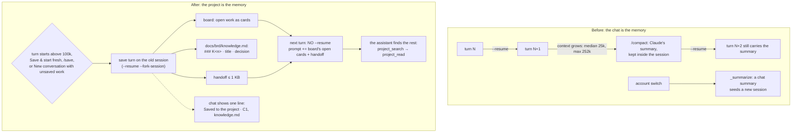
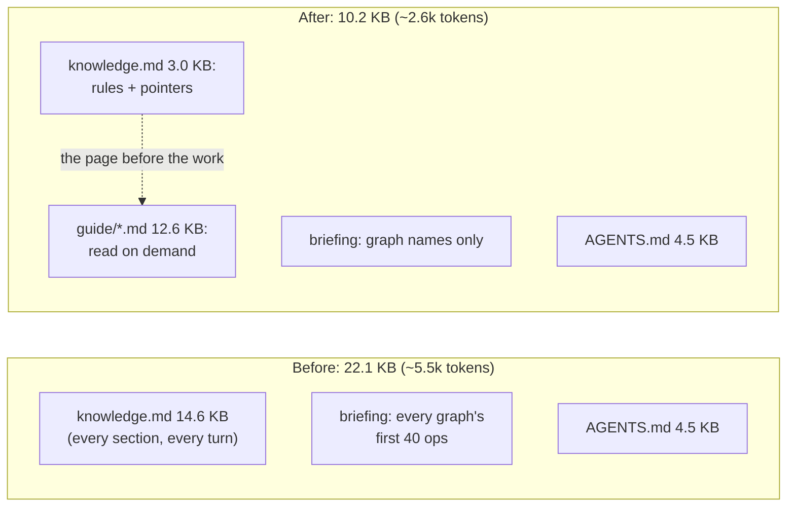

# E6 — The project is the memory (before / after)

Plan: [ENGINEERING_ENV_PLAN.md § E6](../ENGINEERING_ENV_PLAN.md) · board C31 · studio #187 (studio half),
engine half in Operon (`operonx-project search` / `read`).

## What changed, in one picture



## The fixed prompt per turn



Measured on a runline-lab copy: appended prompt + AGENTS.md, bytes/4 (gate 2).

## Code-base structure (operonx-studio)

Before:

```
operonx_studio/
  knowledge.md          14.6 KB: identity, rules, operonx in one page, project layout, traces,
                        building, steps, the board, what the page shows, studio briefing
  assistant.py          Relay: compact turn = Claude's /compact; _summarize() on an account switch
  static/assistant.js   "Compact" button, /compact, doCompact()
```

After:

```
operonx_studio/
  knowledge.md          3.0 KB: identity, reply style, ground rules, find-before-you-read, guide pointers
  guide/                NEW: the sections knowledge.md used to carry, read on demand
    operonx.md            ops, graphs, footguns, project layout, traces
    building.md           plan → cycle → cards, the checklist, the standard
    steps.md              the steps progress card
    board.md              the board tools
    page.md               ox-graph / ox-chart blocks, callouts, how shell calls show
  assistant.py          SAVE_PROMPT, _save() (the save turn), _seed() (board + handoff), SAVE_AT 100k,
                        HANDOFF_MAX 1 KB; _summarize and /compact gone; --add-dir guide/
  chat.py               GUIDE; knowledge() fills {guide}; the briefing names graphs, not their ops
  projectboard.py       seed(): the board's open cards, short, for a fresh session
  mcp.py                project_search, project_read (operonx-project search / read)
  app.py                POST /api/assistant/sessions/{sid}/save; GET /project/search, /project/read;
                        every turn gets seed=_project_seed(scope)
  access.py             the two new routes are "read"
  static/assistant.js   "Save & start fresh" (archive icon), /save, doSave(), newConversation() saves
                        first; renderSaved() draws the one "Saved to the project" line
  static/studio.css     .ax-saved-handoff
```

## Files changed (studio #187)

| File | Change |
|---|---|
| `assistant.py` | save turn + seed replace `/compact` and `_summarize`; auto-save at 100k; handoff column |
| `knowledge.md` | 14.6 KB → 3.0 KB of rules and pointers |
| `guide/*.md` | new: five pages split out of knowledge.md |
| `chat.py` | `{guide}` path filled in; briefing names graphs only |
| `projectboard.py` | `seed()` for a fresh session |
| `mcp.py`, `app.py`, `access.py` | `project_search` / `project_read`; the `/save` endpoint |
| `static/assistant.js`, `studio.css` | Save & start fresh, `/save`, the saved line |
| `runhook.py` | comments point at `guide/page.md` |
| `tests/studio/test_assistant.py`, `test_chat.py` | save, seed, reseed, knowledge ≤ 4 KB, guide pages match |

## Gates

1. **Continuity**: 2 out of 2 on runline-lab with Sonnet ($0.47 and $0.51). Run 1 surfaced two faults, and both were fixed before run 2:
   - the guide pages sat outside the project, so claude refused to read them. Fixed with `--add-dir`.
   - the save wrote `knowledge.md` in a format of its own. Fixed by naming the format in the save prompt.
2. **Fixed prompt**: 22,062 B → 10,205 B.
3. **Context meter**: still open. It needs the next 20 real turns on :8766.
