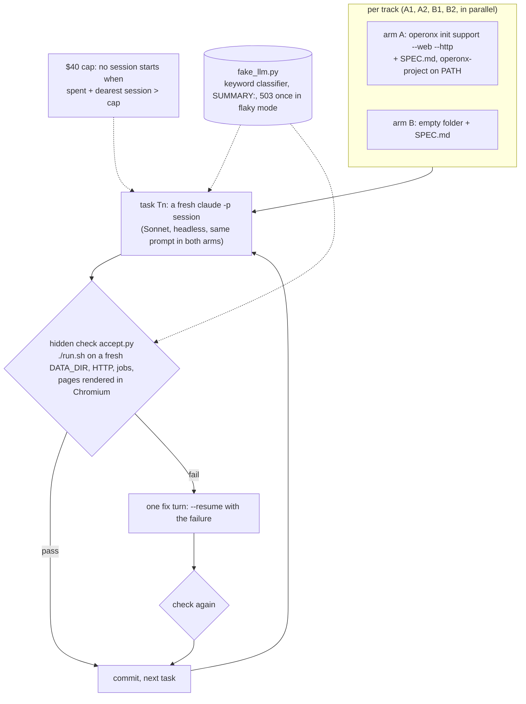

# E7 — Token A/B: the project environment against an empty folder

Plan: [ENGINEERING_ENV_PLAN.md § E7](../ENGINEERING_ENV_PLAN.md) · board C30 · harness [bench/token_ab](../../bench/token_ab/README.md).

## The flow



## Code-base structure (Operon)

```
bench/token_ab/            (new)
  README.md     how to run it, what is counted
  SPEC.md       the product contract both arms get word for word
  tasks.py      T1 tickets+page · T2 daily_summary · T3 category_report · T4 change T2
                T5a/T5b one 503 must not fail · T6 /stats page
  accept.py     the hidden checks, black-box (verified on a reference product: 7/7;
                with the retry and the empty-day branch removed, T4/T5a/T5b fail)
  fake_llm.py   the product's model: OpenAI-compatible, free, deterministic
  run.py        tracks in parallel, fix turn, cost cap, results.jsonl / summary.json
```

## Result

**Arm A cost 2.3× arm B.** All 28 sessions passed the hidden checks. The run spent $4.80, plus
$0.56 on a 2-session pilot, against the $40 cap.

```mermaid
xychart-beta
    title "cost per task, $ (mean of 2 tracks)"
    x-axis [T1, T2, T3, T4, T5a, T5b, T6]
    y-axis "USD" 0 --> 0.5
    bar [0.43, 0.26, 0.18, 0.14, 0.16, 0.19, 0.16]
    bar [0.10, 0.09, 0.09, 0.09, 0.10, 0.12, 0.08]
```


The first bar of each pair is arm A (operonx init), the second arm B (an empty folder).

| per track | A1 | A2 | B1 | B2 |
|---|---|---|---|---|
| cost | $1.54 | $1.96 ($1.49 without the spurious fix turn) | $0.66 | $0.65 |
| turns | 84 | 91 | 47 | 46 |
| doc tokens read | 55.6k | 45.6k | 0 | 0 |
| wall time | 7.4 min | 8.0 min | 3.4 min | 3.3 min |

### What each arm built (A1, B1 at T6)

```
arm A (operonx layout, ~760 lines + tests)        arm B (one package, 250–360 lines, no tests)
app/main.py            Application + services     triager/server.py   http.server routes + pages
src/tickets/ops.py     classify, summarise ops    triager/llm.py      urllib call, retry
src/tickets/graph.py   the flows                  triager/jobs.py     daily_summary, category_report
src/tickets/jobs.py    daily_summary, report      triager/store.py    JSON files in $DATA_DIR
src/tickets/routes.py  HTTP routes                run.sh, job.sh
src/tickets/_store.py, _summaries.py, _reports.py
tests/tickets/         6 test files
web/                   index/stats pages + components
run.sh, job.sh         operonx serve / run
```

### Where the cost goes

- **Docs.** Every arm A session reads the guide, about 6–8k tokens each.
- **Code.** A change in arm A touches routes, ops, graph and a test. In arm B it touches one or two
  files, so arm B needs fewer turns.
- **The gap narrows but never closes.** Setup (T1) costs 4× more in arm A. On T2–T6 it is still 2×
  ($1.08 against $0.56 per track).
- **Repeated work.** T3 (the same shape as T2) cost less than T2 in arm A ($0.18 against $0.26) and
  the same in arm B. T5b (the same bug class as T5a) cost more than T5a in both arms, because the
  task asks for the fix at every model call.
- **Search was barely used.** `operonx-project search`: 8 calls in A1, 0 in A2.

### Caveats

- **A harness bug cost one spurious fix turn.** A2 T1 failed because the check compared text
  case-sensitively, and the page upper-cases its categories with CSS. The $0.47 fix turn was
  spurious. The check is fixed and passes A2's T1 commit.
- **The product is small.** It fits in one file, which favours arm B. The structure arm A pays for
  (tests, layers) has to earn its cost back on a larger product, or over a longer life than seven
  tasks.
- **E6's save turn was not exercised.** No session came near 100k context, and the arms ran plain
  `claude -p`, not the studio.
