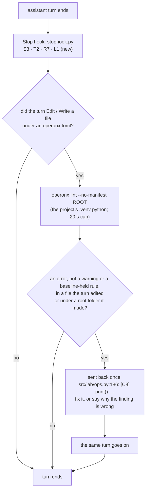

# E8 — Lint after every step (before / after)

Plan: [ENGINEERING_ENV_PLAN.md § E8](../ENGINEERING_ENV_PLAN.md) · board C32 · studio #186 (ad71d01).

## The flow



Before E8, lint ran only when someone typed `operonx lint`. A rule the turn broke got through, and
the next turn found it, or the owner did.

## Code-base structure (operonx-studio)

```
operonx_studio/
  stophook.py      + L1: _project() (nearest operonx.toml), lint_errors() (findings in the edited files)
  assistant.py     hook timeout 10 → 30 s (lint takes 1.1 s on runline-lab, 3.5 s on the callbot)
tests/studio/
  test_stophook.py + L1: an edited file with an error is sent back; an error elsewhere, a warning
                     and a baseline-held rule are not
```

## Result

It takes 1.1 s end to end on runline-lab. In one real turn (Sonnet, $0.10) the assistant was asked to add a `print()`. The hook sent the turn back with
`src/lab/ops.py:186: [C8]`, and the assistant answered why it kept the call: the prompt had asked for it.
