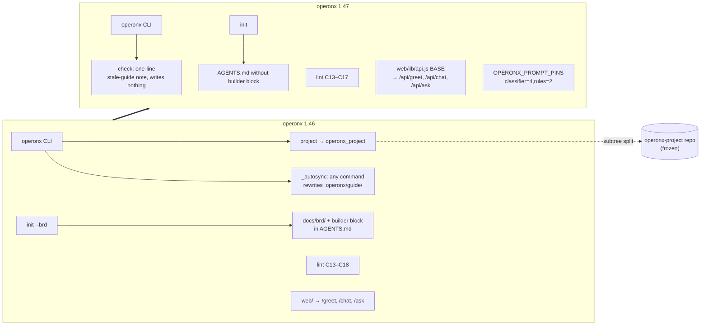

# P2 — operonx-project leaves core (operonx 1.47.0)

Part 2 of [LEAN_PRODUCT_PLAN](../LEAN_PRODUCT_PLAN.md) §5.
After this part, core no longer knows how code gets written: no `operonx project`, no builder block in
AGENTS.md, and no command that quietly rewrites the guide. What it gains is one product feature,
prompt pins, plus the D8 web layout.

**Net: 102 files, +234 / −7,452 lines (−7,218).** 69 of those files (−7,111) are the moved package,
the `project` command, the `_brd` templates and their test.

## Result

| Gate | Result |
|---|---|
| live studio runs P1, `uv sync` dropped operonx-project | done before P2 (studio pid 449844 on :8766) |
| full suite green | 3715 passed, 148 skipped, 1 flaky (see below) |
| `grep -r operonx_project operonx/` | empty |
| `operonx init demo --web` in a temp folder, then `operonx check` | `ok: 5 checks passed` (lint, 3 tests, 1 graph, `POST /api/greet`, `GET /`) |
| `operonx lint .` inside that project | `clean`; `git status` empty afterwards |
| new repo's tests against the local 1.47.0 wheel | 69 passed, 3 skipped (temp venv: the wheel, operonx-project, pytest and pytest-asyncio 1.5.0 from its dev extra) |
| PyPI publish of 1.47.0 | waits for the owner's OK |

The new repo is **batman1m2001-cyber/operonx-project** (private), cut from Operon by `git subtree split`
(main `5abb8647`). It carries `templates/_brd` and the `brd_files` it imports, and pins
`operonx>=1.46` and `operonx-kb>=0.2.6`. It is frozen: nothing in Operon, the studio or the templates
calls it.

## Before → after



```
Operon/                                    Operon/
├── packages/operonx-project/   ✗ (repo)   ├── packages/   (operonx-kb, operonx-agents …)
├── operonx/cli/                           ├── operonx/cli/
│   ├── main.py      DELEGATED.project,    │   ├── main.py      no project, no _autosync
│   │                READ_ONLY, _autosync  │   ├── check.py     + guide_note()
│   ├── check.py                           │   ├── init.py      no --brd, routes under /api/
│   ├── init.py      --brd, brd_files      │   └── templates/   no _brd/
│   ├── project.py   ✗                     │
│   └── templates/_brd/  ✗                 ├── operonx/guide/__init__.py  no builder block
├── operonx/guide/__init__.py  builder     ├── operonx/lint/shape.py      no C18
├── operonx/lint/shape.py      C18         └── operonx/prompts.py         + pins()
└── operonx/prompts.py
```

## Files changed

| File | Change |
|---|---|
| `packages/operonx-project/` | removed (now its own repo) |
| `operonx/cli/project.py`, `templates/_brd/`, `tests/internal/cli/test_project_cli.py` | removed |
| `operonx/cli/main.py` | no `project` entry, no `READ_ONLY`/`_autosync`, no `--brd` group; docstring says only init and guide write the guide |
| `operonx/cli/init.py` | no `brd`/`brd_files`/`BRD`/`BRD_DIR`; template routes `/api/greet`, `/api/chat`, `/api/ask` |
| `operonx/cli/check.py` | `guide_note(root)`: one line after the verdict when `.operonx/guide/` is stale; reads only |
| `operonx/guide/__init__.py` | builder block gone (`BUILDER_*`, `builder_block`, `_sync_builder`) |
| `operonx/prompts.py` | `pins()` reads `OPERONX_PROMPT_PINS`; `_load` uses a pin when no `version=` is given |
| `operonx/lint/shape.py`, `rules.py`, `cli/lint.py` | C18 gone |
| `templates/_common/web/lib/api.js.tmpl` | `export const BASE = ""` and `fetch(BASE + path, …)` |
| `templates/{hello,chat,agent}` src + `test_routes` | routes under `/api/` |
| `templates/_common/AGENTS.md.tmpl`, `dot-gitignore.tmpl`, `README.md.tmpl` | no `{{brd}}`, no `.operonx/project/`, `/api/ask/resume` |
| `guide/05-project-layout.md` | D3 line, the D8 rule, two ways to move `web/` out; no docs/brd |
| `guide/01-ops.md` | pins sentence |
| `guide/09-studio.md`, `guide/README.md` | Board row, board tools, operonx-project mention gone |
| `.github/workflows/packages.yaml`, `tests.yaml` | operonx-project job gone |
| `README.md` | BRD paragraph gone; tree ends at `web/` |
| `bench/token_ab/run.py`, `README.md` | no `PROJECT_BIN`/PATH insert; says operonx-project was on PATH until 1.47.0 |
| `pyproject.toml`, `CHANGELOG.md` | 1.47.0 |
| tests | `test_init` (no other command writes the guide; no `--brd`; D8), `test_check_cli` (stale note, check writes nothing, `/api/` routes), `test_prompts` (pin serves one prompt, neighbours keep their label; run row names the pinned version), `test_shape` (C13–C17) |

## Deviations from the plan

- **All three routes moved under `/api/`**, not only `/greet`: D8 covers every route the pages call.
- **Pins read the prompt files' `.versions`**, the same source `version=` reads. They do not read the
  Postgres prompt store, whose own label path is unchanged.
- **A pin wins over `label=`**: the spec says a pin applies "when no `version=` is given".
- **Builder blocks already in projects stay** as the user's text. P5 removes them from the 5 projects.
- **The stale note is printed after the verdict**, not added as a check line, because the check
  output treats lines 4 and on as routes.
- **`bench/token_ab/run.py` is not ruff-formatted.** It was never formatted, and this part only
  removed lines from it.

## Gate results

- **Full suite** (`--all-extras`): 3715 passed, 148 skipped, 587 deselected, 1 failed in 5:39.
  The failure is `test_clickhouse_store.py::test_a_hung_clickhouse_does_not_slow_a_run_and_drops_past_the_bound`,
  a wall-clock bound under full-suite load. It passed 3 of 3 times when run alone, and P2 does not touch telemetry.
  The suite had 3882 tests before; the removed tests account for the difference.
- `grep -r operonx_project operonx/`: no matches.
- `operonx init demo --web`, then `uv sync`, then `operonx check`: `ok: 5 checks passed`. AGENTS.md has no builder or brd text.
- `operonx lint .` after `git init` and a commit: `clean`, and `git status --short` is empty.
- `uv build --wheel` gives `operonx-1.47.0-py3-none-any.whl`. In a temp venv, operonx-project's suite gives 69 passed, 3 skipped.
