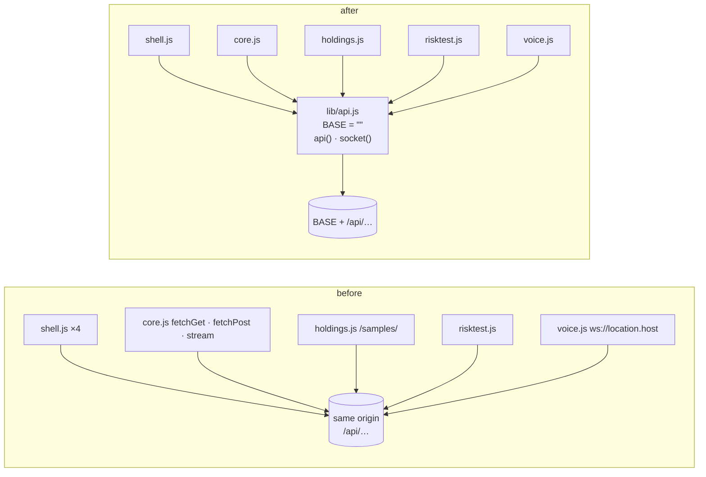

# P5 — the projects: nothing breaks

Part 5 of [LEAN_PRODUCT_PLAN](../LEAN_PRODUCT_PLAN.md) §5.
All five projects now run operonx 1.47.0. None of them depended on operonx-project except through
docs. mr-finance's agent instructions now describe the board and the BRD as plain Markdown, and its
pages reach the backend through one file, `web/lib/api.js`.

## Result

Each project's tests and `operonx check` were run before the bump (on 1.45.0) and after it (1.47.0),
in a fresh clone (callbot in its own checkout).

| Project | PR / commit | Before (1.45.0) | After (1.47.0) |
|---|---|---|---|
| educa-reminder-agent (callbot) | `a38dca1` on `refactor/operonx-studio` (pushed; no MR) | 339 passed; check 12/12 | the same |
| meeting-prep-brd | meeting-prep-projects #20 | 511 passed, 31 skipped; check 5/5 | the same |
| meeting-prep-operonx | meeting-prep-projects #20 | 164 passed, 2 failed (`test_zones`: Postgres auth, model connection); check 4/5 | the same |
| qc-snatcher | qc-snatcher #8 | 1902 passed, 16 failed, 13 errors; check 1/3 | the same, **the same ids** (diffed) |
| mr-finance | mr-finance #91 | 1221 passed, 45 failed, 2 skipped; check 1/4 | the same, **the same ids** (diffed) |

No new failures in any project. The old ones were already on main:

- **qc-snatcher** collects `scripts/_archive/`, and `tests/graphs/test_jev_shadow.py` imports
  `operonx.providers.jev`, which doesn't exist. Without `--continue-on-collection-errors`, both
  versions stop at 7 collection errors. `operonx check`'s build fails on its `databricks` OAuth
  placeholder URL.
- **meeting-prep-operonx**'s two `test_zones` tests need Postgres and a model.
- **mr-finance**'s 45: the 9 UI ones fail on a pristine `ae760ad` too, and the rest are backend tests
  this part doesn't touch (e.g. `test_apply::test_the_endpoints`: the client's impact list is empty).
  `operonx check`'s build and listener need the `http:stt` resource from the local env.

**mr-finance in a browser** (headless Chromium, dark): it signed in with each demo account
(client, rm, cio, admin) and opened every `#/…` link the shell draws, 69 routes. It ran on the live
:8030 copy (old pages) and on the clone served by `operonx serve` (new pages, a read-only copy of the
live state, jobs off, traces to no host). Both: 0 page errors, 0 console errors, 0 responses ≥ 400,
the same routes per role. The clone also called `/api/statement` (the sample upload, now through
`api()`, read 3 items) and `/api/jobs`, which the live run didn't reach.

## Where it differs from the plan

- **Only mr-finance had a generated builder block.** The other four mention operonx-project only
  inside `docs/brd/`, which stays as it is (D7). In mr-finance the block and its hand-written section
  were one region (lines 120–154), so both were replaced together.
- **`core/core.js` had three `fetch` calls, not two.** The third is `stream()` (the assistant's SSE).
  `voice.js`'s WebSocket also took its address from `location.host`. Both now go through
  `lib/api.js`: `api(path, opts)` for fetch, and `socket(path)` for the WebSocket.
- **A test keeps it that way.** `test_the_pages_reach_the_backend_only_through_lib_api` fails if any
  `fetch(`, `new EventSource(`, or a `new WebSocket(` whose address isn't `socket(…)`, appears outside
  `web/lib/api.js`. Its first version also flagged `new WebSocket(socket(…))`; the full run caught it.
- **The callbot commit is on the branch only.** Callbot work stays on `refactor/operonx-studio`, so
  there is no merge request.
- **The live :8030 restart is the owner's.** The bump is merged; `~/mr-finance` still has someone's
  uncommitted edits, so it is not pulled or restarted here.

## Before → after (mr-finance web/)

To serve `web/` from another host later, change `BASE` to the backend's origin. That one line
moves it (D8), plus CORS on the backend, or a reverse proxy that keeps it same-origin.

## Code changes

| Repo | File | Change |
|---|---|---|
| mr-finance | `AGENTS.md` | the builder block (`<!-- operonx:builder -->`, 35 lines) is now "docs/brd and the board", 30 lines: plain Markdown edited directly. The card status goes in its heading; summary counts are updated by hand; search is `grep -rn`; a plan is a `## ID · title · open` section on the board |
| mr-finance | `web/lib/api.js` | new: `BASE`, `api()`, `socket()` |
| mr-finance | `web/shell.js`, `core/core.js`, `pages/holdings.js`, `pages/risktest.js`, `voice.js` | each `fetch` → `api`; the WebSocket → `socket` |
| mr-finance | `tests/test_web.py` | the guard test above; `/lib/api.js` is served |
| all five | `pyproject.toml`, `uv.lock` | `operonx…>=1.47.0`, locked at 1.47.0 |
