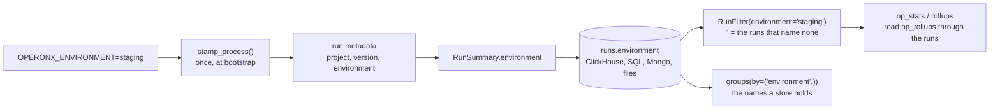

# E1: a run carries its deployment's environment (operonx)

Plan: `docs/RUN_ENVIRONMENT_PLAN.md`. Done 2026-11-28.

## Result

A deployment sets `OPERONX_ENVIRONMENT=staging` (its environment or its `.env`). Every run it
makes carries the name; every run store keeps it, filters by it and lists the names it holds.



## Changed from the plan

The plan put the column on `runs` and `op_rollups`. Only `runs` has it: `rollups()` and
`op_stats()` already choose their rows by `trace_id IN (SELECT trace_id FROM runs WHERE …)`,
so Monitor's numbers follow a run filter with no second column.

## Code

```text
operonx/app/origin.py              environment(): reads and checks the variable; stamp_process adds it
operonx/telemetry/runs/model.py    RunSummary.environment; RunFilter.environment; "environment" in _NAMED
operonx/telemetry/runs/base.py     "environment" in GROUP_FIELDS
operonx/telemetry/runs/sql.py      a summary column (SQLite and Postgres add it to a table that lacks it); the filter
operonx/telemetry/runs/clickhouse.py   the column in the runs table; migration 6; the filter
operonx/telemetry/runs/mongo.py    the filter
operonx/guide/02-composition.md    the setting, beside OPERONX_TRACE
```

## Checked

- The contract tests on files, SQLite, Mongo and a throwaway ClickHouse: the filter by name, by
  none, with another filter; the names a store holds (`tests/internal/telemetry/test_run_store.py`).
- A bad name stops the process; a process that names none carries none.
- `test_live_an_older_writer_keeps_writing_to_a_database_a_newer_one_migrated`: a database at
  schema 5 without the column, a run written by a writer that does not know it, the newer store
  opening it (schema 6), the older writer writing again. All three runs read back; the older
  ones have no environment; `op_stats` follows the filter. This is the callbot's deploy order:
  staging first, production still on the previous operonx.
- 1,107 tests of `tests/internal/telemetry` and `tests/internal/app` pass.

Not checked here: Postgres (no test server set).
