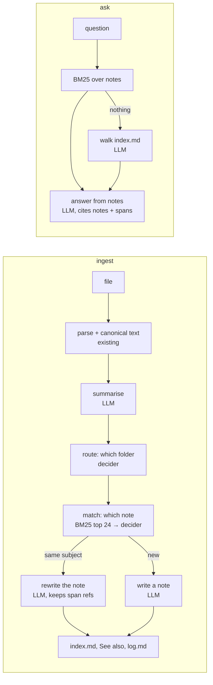

# The knowledge base as an LLM wiki — plan (closed)

**Status:** CLOSED 2026-11-23 by the owner, nothing built and not to be built. On harder sets too (reworded questions, 60 multi-step ones) the answer was a search loop over the kb (`kb.ask(searches=N)`), not a wiki: CROW answered 39/60 multi-step questions, a kb search loop 57/60. On the same 200 documents and 120 Vietnamese questions
(corpus_vi), the kb as it is answered better and cheaper than llm-wiki-v2 1.0.5 run unchanged. Every system used the
same answering model, deepseek-v4.1-flash:

| | Right | Cited the right document | Cost | Ingest |
|---|---|---|---|---|
| kb: lexical (FTS5, `vi`+fold) + `kb.ask` | 119/120 | 119 | $0.02 | 38 s, no model |
| llm-wiki-v2 CROW (Jev files the documents) | 117/120 | 113 | $1.32 | 48 min |
| llm-wiki-v2 classic (the LLM files them; this plan's design) | 64/120 | 46 | $1.25 | 47 min |

Each question asks for one fact of one unit, so a wiki brings nothing the search does not already give. Reopen
this plan only for a question set the kb loses: questions that need several documents.
**Owner's brief:** refactor the knowledge base on LLM Wiki v2: no RAG, no embeddings.
**Sources read:** the CROW preprint (Cesarini, Sassarini, 2026, [zenodo 23260209](https://zenodo.org/records/23260209), CC BY 4.0)
and the [crow-hq/llm-wiki-v2](https://github.com/crow-hq/llm-wiki-v2) README.

## 1. What an LLM wiki is, in one example

Today a file becomes chunks, and a question finds chunks:

```
policy.pdf ──► 14 chunks ──► FTS (+ vectors) ──► question finds chunk 9 ──► answer cites chunk 9's span
```

In a wiki a file is read once by a model, which files what it learned into notes a person can open:

```
wiki/
  index.md                 one line per folder
  log.md                   what changed, newest first
  leave-policy/
    index.md               one line per note: link + description
    annual-leave.md        a note: frontmatter (title, description, sources) + text + "See also"
    sick-leave.md
```

A second file about annual leave updates `annual-leave.md` instead of adding 14 more chunks. A question
finds notes (word search over notes, then a walk down the `index.md` files when search finds nothing),
and the answer cites the notes.

## 2. What we take, and what we do not

| from LLM Wiki v2 | decision | why |
|---|---|---|
| Notes in topic folders, `index.md` per folder, `log.md`, a `raw/` copy of each source | **take** | this is the idea |
| A new source updates the note on its subject; an unchanged source is skipped | **take** | we already have versions and content hashes |
| Answers cite notes; conflicting notes are reported, not averaged | **take** | |
| Word search (BM25) over notes to pick candidates | **take** | we have it: SQLite FTS5 / Postgres FTS with the Vietnamese analyzer |
| An optional embedder beside BM25 | **leave out** | the owner's rule; and on our sets lexical alone is already level with hybrid (§3) |
| CROW: a typed classifier (Jev) makes the filing decisions | **leave out for now** | Jev was measured here for tool selection and closed (no cost or latency gain, 2026-10-18). The decider is an interface, so a classifier can be added if W0 shows the LLM decider failing |
| Its code | **none of it** | AGPL-3.0. We build from the paper and the described behaviour, as ops and graphs of our own (the same rule as docling) |

What we keep that it does not have: **a citation that reaches the page.** Their answer cites a note.
Ours cites a note, and every sentence of a note carries the source spans it was written from
(version, span → page, bbox), verified against the text as today. A reader can go answer → note →
the highlighted lines of the PDF.

## 3. What the numbers we have say (so the gate is honest)

From `docs/bench/k2.md`, Recall@10:

| set | lexical | hybrid (lexical + vectors) |
|---|---|---|
| xquad_vi (397 cases) | 0.998 | 0.998 |
| xquad_en (397) | 0.990 | 0.998 |
| corpus_vi (119) | 1.000 | 1.000 |

- Dropping vectors costs nothing measurable on these sets. mr-finance already runs lexical only.
- So the wiki cannot win on "finds the passage": that is already ~1.0. It has to win elsewhere, or it
  is not worth its model calls:
  1. **questions that need several documents** (the chunk path answers from whichever chunks rank first);
  2. **a base a person can read and correct** (open a note, fix it, the fix is the knowledge);
  3. **less machinery** (no chunker settings, no embedder, no vector store, no reranker, no index generations).
- Its known risk, from the paper's own figures: with the LLM making every filing decision ("classic"),
  right-note accuracy fell from 76% to 60% on 1,000 emails. Their fix is the classifier. W0 measures
  where our LLM decider stands before anything is removed.

## 4. The design



- **A collection is a wiki.** Notes live in the catalog (SQLite or Postgres, as now) and export to a
  folder of Markdown; the folder is a view, the catalog is the truth, so ACLs, filters and versions
  keep working.
- **A note** has: id, folder, title, one-line description, text, and for each paragraph the source
  spans it came from. Deleting a source marks the paragraphs that came only from it.
- **The decider** is one interface with two questions: "which of these folders?" and "the same subject
  as one of these notes, or new?". Default: an LLM call with a closed list of choices (at most 24
  candidates, so cost per file does not grow with the base). Unsure means "new note", never a merge.
- **Every model step is an op** with a fake for tests; ingest is resumable per file; model answers are
  cached by input hash (re-ingesting an unchanged file costs nothing).
- **Removed at the end** (about 2,600 lines today): chunkers, the dense index and its ledger,
  embedders, vector-store adapters, the reranker, hybrid fusion, the tree index (K4), the concept graph
  and PageRank search (K6), and the visual-retrieval backlog item (K5). Parsing, PDF layout, canonical
  text, spans, verified citations, the catalog, blobs, FTS, the admin API, `kb_tools`, MCP and the
  eval harness stay.

## 5. Phases and gates

Each phase is one branch and one PR; the old path keeps working until W5.

| phase | scope | gate |
|---|---|---|
| **W0** spike, measured | Ingest and ask as two plain graphs, no storage change, on `corpus_vi` (200 docs, 120 cases) and a new 30-case multi-document set written from the same corpus | Decision to continue: single-fact answers within 2 points of today's cited answers; multi-document answers better than today's by a paired test; right-note rate ≥ 90%; cost per document and per question reported. If right-note rate is under 90%, stop and decide on a classifier before W1 |
| **W1** model and store | `Note`, `Folder`, paragraph → spans, in both catalogs with a migration; FTS over notes; Markdown export | Catalog conformance on SQLite and Postgres; export → import round-trips |
| **W2** ingest | The ingest graph; versions (an updated source rewrites its notes, an unchanged one is skipped); delete; resume | The W0 numbers hold through the real graph; re-ingest of an unchanged corpus makes 0 model calls |
| **W3** ask | Search, walk, answer with note and span citations, conflicts reported; `kb_tools` and MCP on notes | Citation precision ≥ 0.9 on 30 live answers (today 0.83, the open K2 gate) |
| **W4** upkeep | `check` (broken links, index drift), move, rename, split a grown folder, a person's edit to a note is kept on the next ingest; admin API `operonx-kb/2` (tree, note, sources) | Every upkeep command covered on the fake model; an edited note survives a re-ingest |
| **W5** switch | Studio's Knowledge tab reads `/2` (a tree of notes, a note beside its source page); mr-finance moves over; the old path and its extras are deleted; 0.3.0 | Both consumers green; net lines removed > added |

After W5, separately: `operonx-project`'s `knowledge.md` and its search already are word search over
Markdown. They can become one small wiki per project with the same note format, with no model needed
to read it. Not in this plan's gates.

## 6. Cost and rules

- **Budget: US$10 of model calls for W0–W3**, counted per phase in `docs/bench/wiki.md`; stop and
  report at the cap. Sonnet for writing notes and answers, Haiku for the decider; no other provider
  mid-comparison. No embedding calls at all.
- Tests run on fake models only. Live runs are the gates above and nothing else.
- No code from llm-wiki-v2 (AGPL). No new dependency.
- operonx standard: ops and module-level graphs, the operonx logger, no `print`; upstream gaps become
  operonx PRs.

## 7. What the owner decides

**Approve W0** (the spike, about US$2 of model calls, no storage change). Everything after it depends
on its numbers, and W0's result comes back as a go / stop recommendation before W1.

Decided here, say so to change it: the dense path is deleted at W5 with no flag kept. Lexical is level
with hybrid on every set we have, the only project that depends on the package (mr-finance) is
lexical only, and the lean rule is to remove more than we add.
