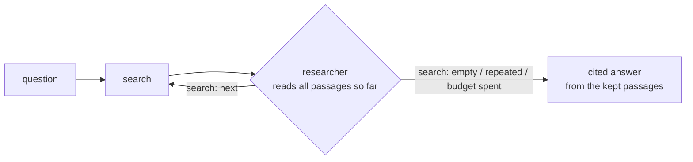

# `kb.ask(searches=N)`: the research loop

Measured 2026-11-23 on `corpus_vi` (200 documents, 1 358 chunks, a hybrid collection: FTS5 `vi`+fold
and e5-small) with deepseek-v4.1-flash for both the researcher and the answer. `searches=6`.

## Result

| set | one search (`kb.ask`) | search-tool agent (hand-written) | `kb.ask(searches=6)` | llm-wiki-v2 CROW |
|---|---|---|---|---|
| reworded questions, para_p2 (120) | 107 | 119 | **120** ($0.046) | 113 |
| multi-step (60: compare, bridge, hop, argmax; judged) | 40 | 57 ($0.062) | **59** ($0.060) | 39 |

Multi-step needs a mean of 2.1 searches: 29 of the 60 questions need one, and 5 use all 6. A reworded
question needs a mean of 1.2. The one miss (bridge-02) searched six times for the unit with a 4th-floor
room booked through Phòng Xanh, never found it, and said so. It stated no wrong fact.

## What moved it from 48 to 59

The first run gave the researcher only the first 700 characters of each passage and scored 48/60. In 11 of
the 12 misses the fact the question needed sat past character 700 of its chunk (38% of this corpus's chunks
are longer than that). So the researcher never saw the fact, searched again, and did not keep the passage.
Whole passages (capped at 2 000 characters) fixed 11 of the 12.

## How it works

`answer["research"]` lists the searches, and `answer["usage"]` totals every model call.
